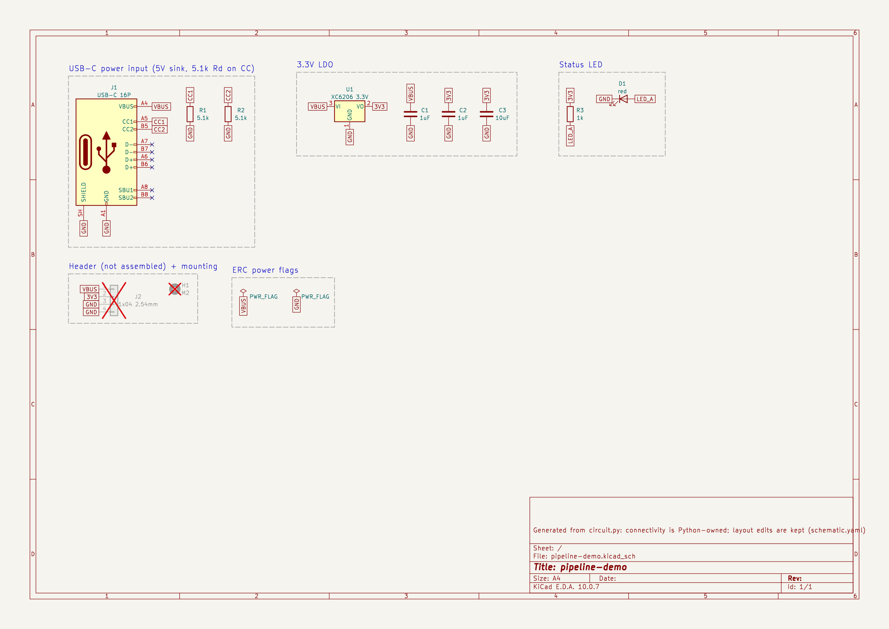

# pipeline-demo: review gate 1
_generated 2026-10-11 13:38 · checks PASS_

## BOM
| refs | value | MPN | LCSC | tier | stock | unit $ |
|---|---|---|---|---|---|---|
| C1, C2 | 1uF | CL05A105KA5NQNC | C52923 | basic | 7,473,805 | 0.0087 |
| C3 | 10uF | CL10A106KP8NNNC | C19702 | basic | 10,369,080 | 0.0305 |
| D1 | red | KT-0603R | C2286 | basic | 7,258,640 | 0.0076 |
| J1 | USB-C 16P | TYPE-C-31-M-12 | C165948 | extended | 408,411 | 0.186 |
| R1, R2 | 5.1k | 0402WGF5101TCE | C25905 | basic | 5,603,466 | 0.0024 |
| R3 | 1k | 0402WGF1001TCE | C11702 | basic | 8,264,648 | 0.0035 |
| U1 | XC6206 3.3V | XC6206P332MR-G | C5446 | basic | 422,914 | 0.1429 |

## Schematic (generated from circuit.py; read it next to the datasheets)

- ✓ `schematic/pins_match` all 38 symbol pins match parts.yaml
- ✓ `schematic/netlist_match` KiCad's netlist of the schematic equals circuit.py (6 nets)

## Pin tables (pad → KiCad symbol name / parts.yaml name → electrical type → net)

**J1**

| pad | symbol | ours | type | net |
|---|---|---|---|---|
| A1 | GND | GND | passive | GND |
| A4 | VBUS | VBUS | passive | VBUS |
| A5 | CC1 | CC1 | bidirectional | CC1 |
| A6 | D+ | DP1 | bidirectional | NC |
| A7 | D- | DN1 | bidirectional | NC |
| A8 | SBU1 | SBU1 | bidirectional | NC |
| A9 | VBUS | VBUS | passive | VBUS |
| A12 | GND | GND | passive | GND |
| B1 | GND | GND | passive | GND |
| B4 | VBUS | VBUS | passive | VBUS |
| B5 | CC2 | CC2 | bidirectional | CC2 |
| B6 | D+ | DP2 | bidirectional | NC |
| B7 | D- | DN2 | bidirectional | NC |
| B8 | SBU2 | SBU2 | bidirectional | NC |
| B9 | VBUS | VBUS | passive | VBUS |
| B12 | GND | GND | passive | GND |
| SH | SHIELD | SHIELD | passive | GND |

**R1**

| pad | symbol | ours | type | net |
|---|---|---|---|---|
| 1 | — | 1 | passive | CC1 |
| 2 | — | 2 | passive | GND |

**R2**

| pad | symbol | ours | type | net |
|---|---|---|---|---|
| 1 | — | 1 | passive | CC2 |
| 2 | — | 2 | passive | GND |

**U1**

| pad | symbol | ours | type | net |
|---|---|---|---|---|
| 1 | GND | VSS | power_in | GND |
| 2 | VO | VOUT | power_out | 3V3 |
| 3 | VI | VIN | power_in | VBUS |

**C1**

| pad | symbol | ours | type | net |
|---|---|---|---|---|
| 1 | — | 1 | passive | VBUS |
| 2 | — | 2 | passive | GND |

**C2**

| pad | symbol | ours | type | net |
|---|---|---|---|---|
| 1 | — | 1 | passive | 3V3 |
| 2 | — | 2 | passive | GND |

**C3**

| pad | symbol | ours | type | net |
|---|---|---|---|---|
| 1 | — | 1 | passive | 3V3 |
| 2 | — | 2 | passive | GND |

**R3**

| pad | symbol | ours | type | net |
|---|---|---|---|---|
| 1 | — | 1 | passive | 3V3 |
| 2 | — | 2 | passive | LED_A |

**D1**

| pad | symbol | ours | type | net |
|---|---|---|---|---|
| 1 | K | K | passive | GND |
| 2 | A | A | passive | LED_A |

**J2**

| pad | symbol | ours | type | net |
|---|---|---|---|---|
| 1 | Pin_1 | 1 | passive | VBUS |
| 2 | Pin_2 | 2 | passive | 3V3 |
| 3 | Pin_3 | 3 | passive | GND |
| 4 | Pin_4 | 4 | passive | GND |

## Pinout evidence (ICs and connectors)
- **J1** TYPE-C-31-M-12 (C165948): USB Type-C spec pin names; KiCad footprint is specific to this exact part (HRO TYPE-C-31-M-12), pads named by spec pin — verified 2026-10-11
  - pin map: GND=A1/A12/B1/B12, VBUS=A4/A9/B4/B9, CC1=A5, CC2=B5, DP1=A6, DN1=A7, DP2=B6, DN2=B7, SBU1=A8, SBU2=B8, SHIELD=SH
- **U1** XC6206P332MR-G (C5446): Torex ETR0305_004b p.2 PIN ASSIGNMENT, SOT-23 column (1=VSS, 2=VOUT, 3=VIN) — verified 2026-10-11
  - pin map: VSS=1, VOUT=2, VIN=3
  - note: Torex original. Clones (e.g. UMW XC6206P332MR) are documented with different pin orders, so never substitute without re-checking. Vin max 6.0V operating.
- **J2** PinHeader_1x04 (None): generic header, pin n = pad n — verified 2026-10-11
  - pin map: 1=1, 2=2, 3=3, 4=4
- **H1** MountingHole_M2 (None): mechanical, no pins — verified 2026-10-11
  - pin map: 

## Design assertions
- ✓ LED current @Vf=1.8V: 0.0015 A (allowed 0.0005 … 0.005)
- ✓ LED current @Vf=2.4V: 0.0009 A (allowed 0.0005 … 0.005)
- ✓ LDO input max vs XC6206 6.0V rating: 5.25 V (allowed 0 … 6)
- ✓ LDO dissipation @100mA, Vin=5.25V: 0.195 W (allowed 0 … 0.25)

## Nets
- `VBUS` (Power): J1.VBUS, U1.VIN, C1.1, J2.1
- `GND` (Power): J1.GND, J1.SHIELD, R1.2, R2.2, U1.VSS, C1.2, C2.2, C3.2, D1.K, J2.3, J2.4
- `CC1` (Default): J1.CC1, R1.1
- `CC2` (Default): J1.CC2, R2.1
- `3V3` (Power): U1.VOUT, C2.1, C3.1, R3.1, J2.2
- `LED_A` (Default): R3.2, D1.A
- NC: J1.DN1, J1.DN2, J1.DP1, J1.DP2, J1.SBU1, J1.SBU2
