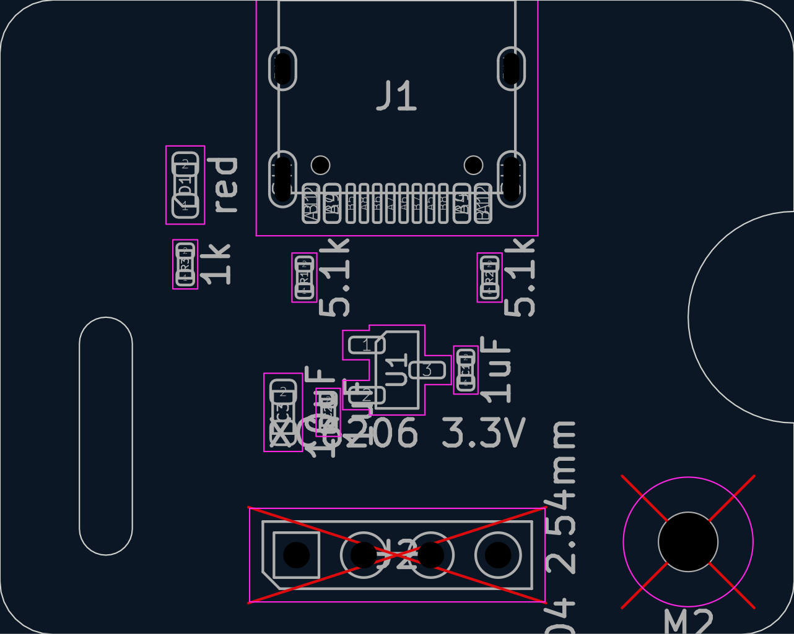
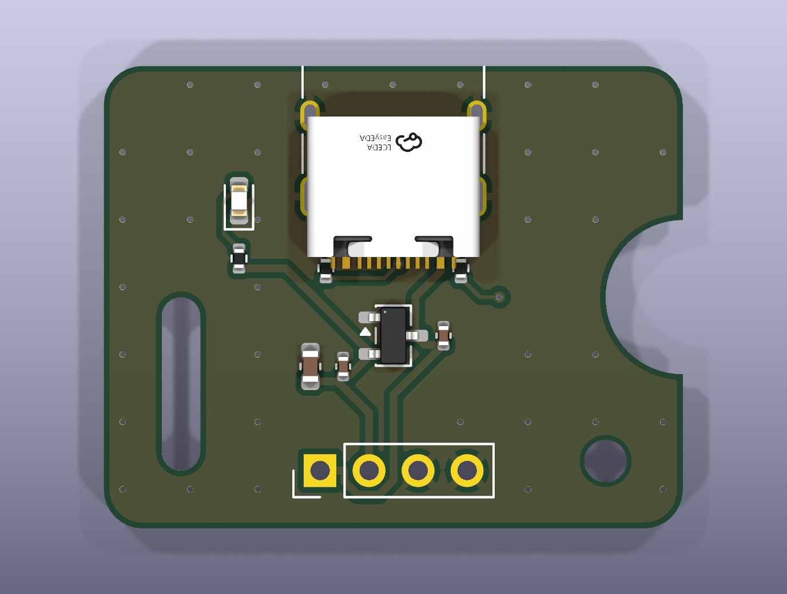
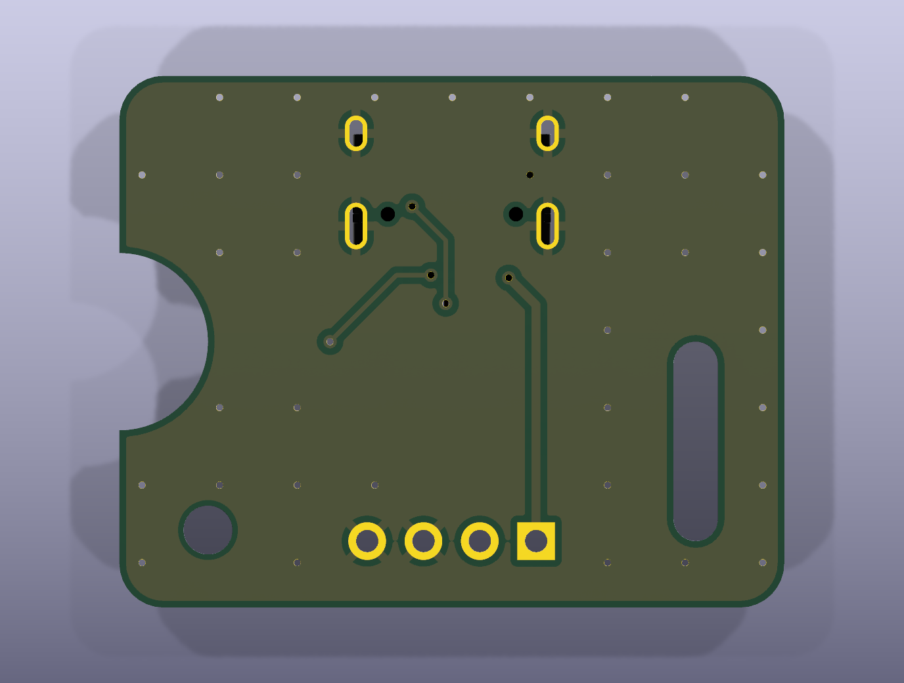

# pipeline-demo: review gate 2
_generated 2026-10-11 09:57 · checks PASS_

## Renders

## Placement rules
- ✓ C1 -> U1 pad 3: 1.54 mm (max 3.0) — LDO input cap
- ✓ C2 -> U1 pad 2: 1.47 mm (max 3.0) — LDO output cap
- ✓ J1 courtyard -0.52 mm from top edge — USB-C mouth must reach the board edge

## Placement intent (from placement.yaml)
- J1: {'at': [15.0, 3.65], 'rot': 180}
- R1: {'at': [11.5, 10.5], 'rot': 90}
- R2: {'at': [18.5, 10.5], 'rot': 90}
- U1: {'at': [15.0, 14.0], 'rot': 0}
- C1: {'at': [17.6, 14.0], 'rot': 90}
- C2: {'at': [12.4, 15.6], 'rot': 90}
- C3: {'at': [10.7, 15.6], 'rot': 90}
- D1: {'at': [7.0, 7.0], 'rot': 90}
- R3: {'at': [7.0, 10.0], 'rot': 90}
- J2: {'at': [11.2, 21.0], 'rot': 90}
- H1: {'at': [26.0, 20.5]}
