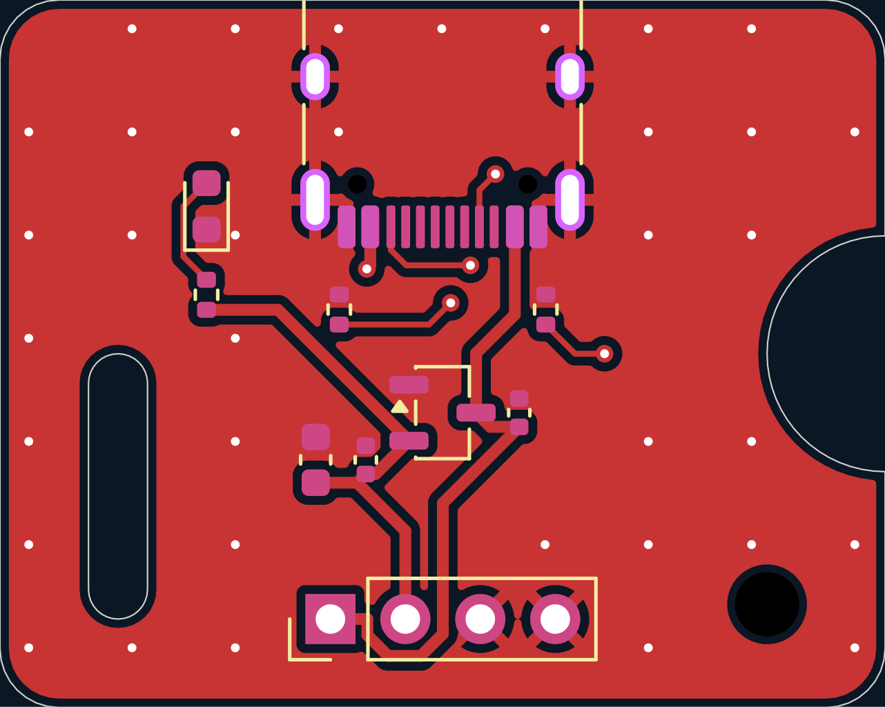
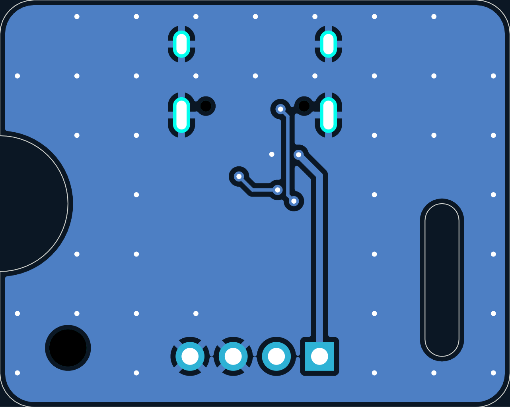
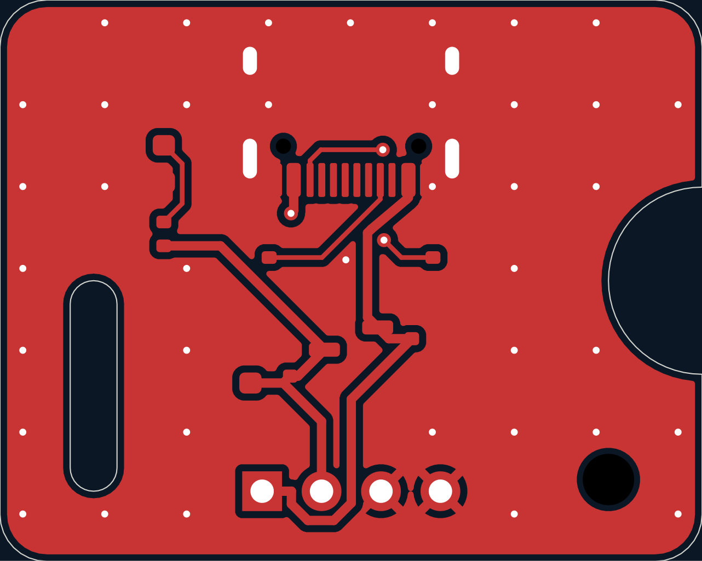
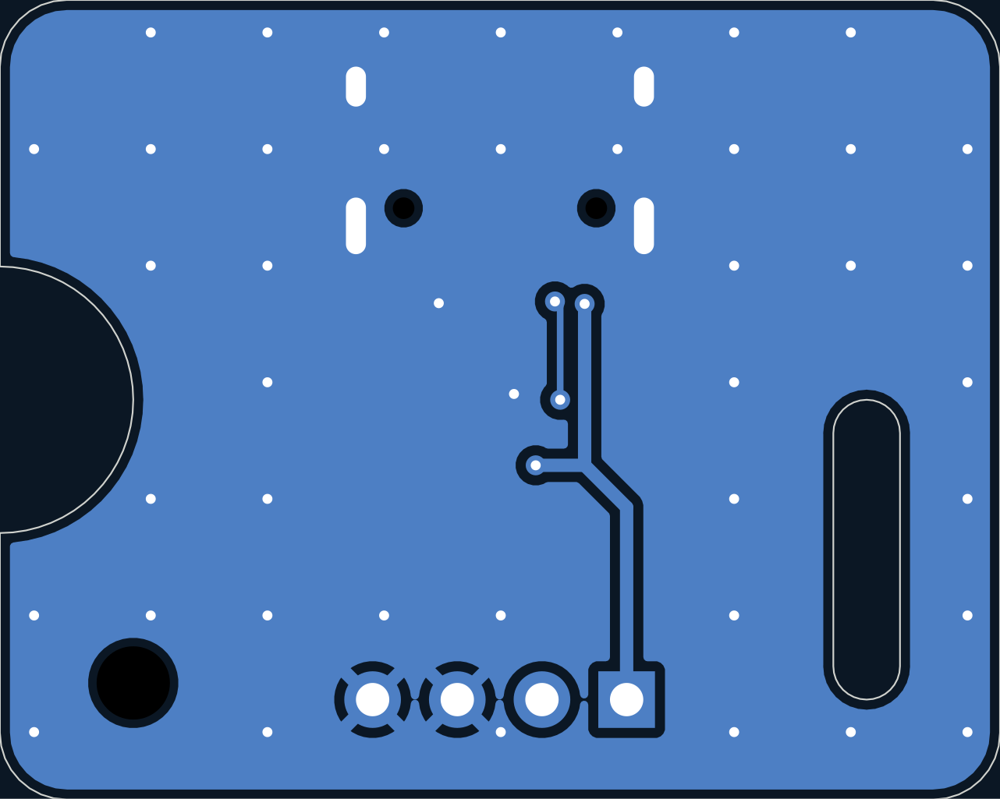
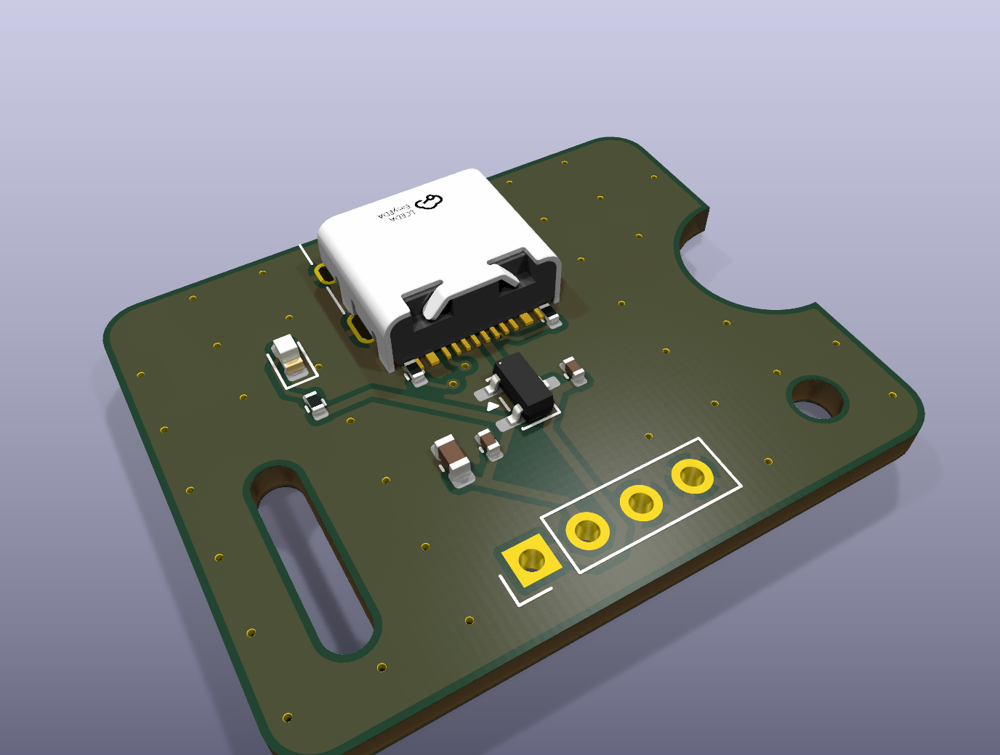

# pipeline-demo: review gate 3
_generated 2026-10-11 11:20 · checks PASS_

## Renders

## Fab files (build/fab/)
- cpl_corrections.json
- pipeline-demo-bom.csv
- pipeline-demo-cpl.csv
- pipeline-demo-gerbers.zip
- pipeline-demo.kicad_pcb

## CPL rotation corrections applied (UNVERIFIED until you check JLC's preview)
- J1 `USB_C_Receptacle_HRO_TYPE-C-31-M-12`: +0° (rule `^USB_C_Receptacle_HRO_TYPE-C-31-M-12`, confirmed)
- U1 `SOT-23-3`: +180° (rule `^SOT-23`, confirmed)

Parts cost per board ≈ $0.39 + extended-part fees (1 unique extended)

## Before paying
1. Upload the gerber zip; inspect JLC's Gerber viewer (outline, cutouts, drills).
2. Upload BOM + CPL; check EVERY part's rotation/polarity in JLC's placement preview.
3. Record corrections in lib/jlc_rotations.csv (top of file), rebuild, re-upload.
4. After ordering: `git tag <board>/vX.Y` and note the order number in spec.md.
