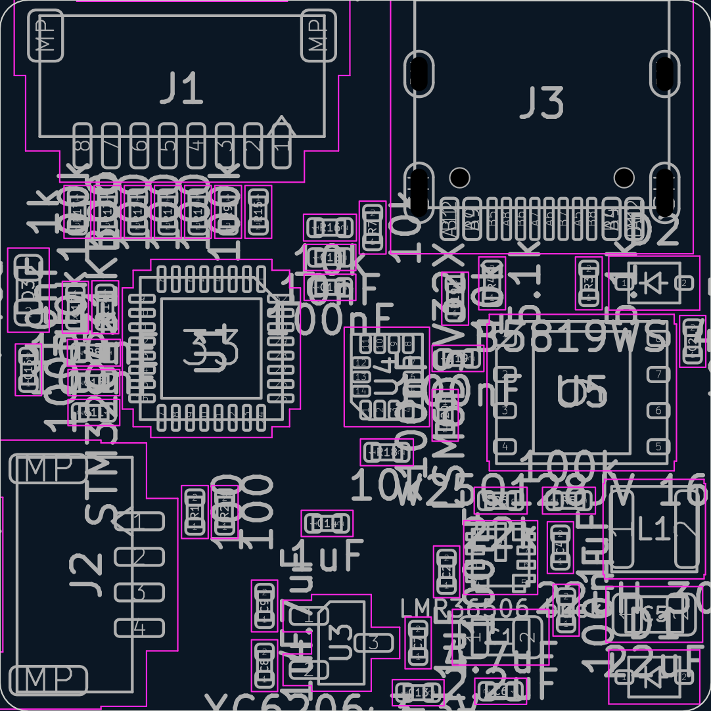
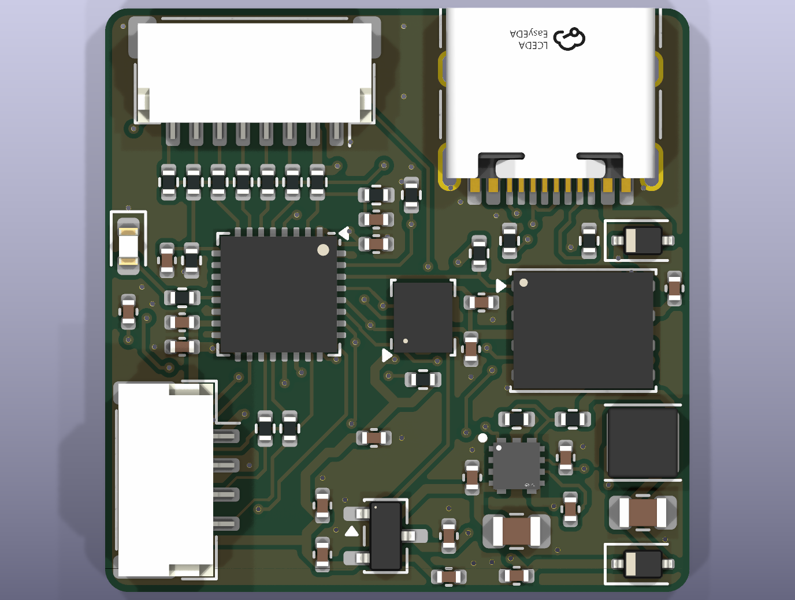
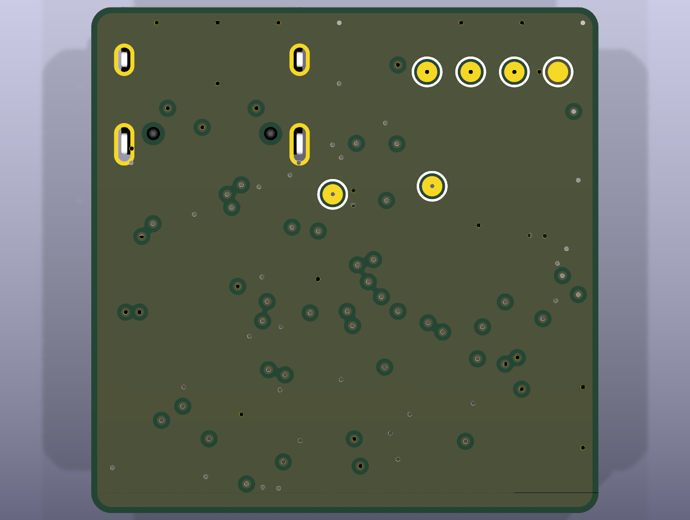

# rebot-ctrl-v2: review gate 2
_generated 2026-10-13 15:48 · checks PASS_

## Renders

## Placement rules
- ✓ C10 -> U1 pad 1: 1.96 mm (max 2.5) — MCU VDD (pin 1) decoupling
- ✓ C11 -> U1 pad 17: 1.91 mm (max 2.3) — MCU VDD (pin 17) decoupling
- ✓ C15 -> U1 pad 15: 1.21 mm (max 2.2) — VDDA HF decoupling
- ✓ R14 -> U1 pad 9: 1.31 mm (max 1.9) — CURR divider at PA4
- ✓ C17 -> U1 pad 9: 2.35 mm (max 2.9) — CURR filter at PA4
- ✓ R16 -> U1 pad 2: 3.02 mm (max 4.2) — VBAT divider bottom; PF0's top side is the DShot fan, so it sits in the right strip (DC signal)
- ✓ C18 -> U1 pad 2: 2.56 mm (max 5.3) — VBAT filter (10 nF on a 100k/10k divider, DC): beside R16
- ✓ R8 -> U1 pad 13: 1.19 mm (max 2.1) — LED resistor at PB0
- ✓ R1 -> J2 pad 3: 3.03 mm (max 3.5) — CRSF in series R, upright between the MCU and J2 (the corridor left of the USB vias)
- ✓ R2 -> J2 pad 4: 4.66 mm (max 5.1) — CRSF out series R, beside R1
- ✓ C19 -> U4 pad 8: 1.37 mm (max 1.8) — IMU VDD decoupling
- ✓ C20 -> U4 pad 5: 1.20 mm (max 2.4) — IMU VDDIO decoupling
- ✓ C21 -> U5 pad 8: 1.26 mm (max 2.1) — flash VCC decoupling
- ✓ C2 -> U2 pad 4: 1.08 mm (max 1.6) — buck VIN HF
- ✓ C1 -> U2 pad 4: 1.89 mm (max 2.4) — buck VIN bulk
- ✓ C3 -> U2 pad 6: 1.79 mm (max 1.8) — buck BOOT
- ✓ C4 -> U2 pad 7: 1.26 mm (max 1.9) — buck VCC
- ✓ R6 -> U2 pad 8: 1.13 mm (max 1.5) — buck FB divider
- ✓ L1 -> U2 pad 5: 3.93 mm (max 4.4) — buck inductor at SW (C3 and R5 sit between them; SW trace ~3.5 mm)
- ✓ C7 -> U3 pad 3: 1.63 mm (max 2.1) — LDO input cap at VIN (pad 3)
- ✓ C8 -> U3 pad 2: 1.60 mm (max 2.2) — LDO output cap at VOUT (pad 2)
- ✓ J1 courtyard -0.18 mm from top edge — ESC cable plugs in from the top edge
- ✓ J3 courtyard -0.52 mm from top edge — USB-C mouth at the top edge (reachable with the lid off)
- ✓ J2 courtyard -0.17 mm from left edge — receiver cable comes from the robot left side

## Placement intent (from placement.yaml)
- J1: {'at': [6.4, 3.125], 'rot': 180}
- J3: {'at': [19.05, 3.65], 'rot': 180}
- J2: {'at': [3.05, 20.2], 'rot': 270}
- R17: {'at': [2.72, 7.45], 'rot': 270}
- R13: {'at': [3.78, 7.45], 'rot': 270}
- R12: {'at': [4.84, 7.45], 'rot': 270}
- R11: {'at': [5.9, 7.45], 'rot': 270}
- R10: {'at': [6.96, 7.45], 'rot': 270}
- R9: {'at': [8.02, 7.45], 'rot': 270}
- R15: {'at': [9.08, 7.45], 'rot': 270}
- U1: {'at': [7.43, 12.25], 'rot': 270}
- R16: {'at': [11.6, 8.0], 'rot': 0}
- C18: {'at': [11.6, 9.05], 'rot': 0}
- C10: {'at': [11.6, 10.1], 'rot': 0}
- R14: {'at': [3.7, 10.8], 'rot': 270}
- C17: {'at': [2.65, 10.8], 'rot': 270}
- R8: {'at': [3.3, 12.4], 'rot': 180}
- D3: {'at': [1.0, 10.2], 'rot': 270}
- C15: {'at': [3.3, 13.45], 'rot': 180}
- C14: {'at': [11.5, 18.4], 'rot': 0}
- C11: {'at': [3.3, 14.5], 'rot': 180}
- C13: {'at': [14.7, 24.35], 'rot': 0}
- U4: {'at': [13.6, 13.25], 'rot': 90}
- C19: {'at': [16.1, 12.6], 'rot': 0}
- C20: {'at': [15.65, 14.6], 'rot': 270}
- R18: {'at': [13.6, 15.9], 'rot': 0}
- U5: {'at': [20.45, 13.8], 'rot': 0}
- C21: {'at': [24.35, 12.0], 'rot': 90}
- R19: {'at': [16.0, 10.5], 'rot': 90}
- R4: {'at': [17.3, 9.96], 'rot': 90}
- R3: {'at': [20.7, 9.96], 'rot': 90}
- D2: {'at': [23.0, 9.95], 'rot': 0}
- R1: {'at': [6.85, 18.0], 'rot': 90}
- R2: {'at': [7.9, 18.0], 'rot': 90}
- U2: {'at': [17.6, 19.6], 'rot': 0}
- C2: {'at': [15.7, 20.1], 'rot': 90}
- C1: {'at': [17.6, 22.4], 'rot': 0}
- R6: {'at': [17.6, 17.6], 'rot': 0}
- C4: {'at': [19.7, 19.25], 'rot': 90}
- C3: {'at': [19.9, 21.45], 'rot': 90}
- R5: {'at': [20.0, 17.6], 'rot': 180}
- L1: {'at': [23.0, 18.6], 'rot': 0}
- C5: {'at': [23.0, 21.6], 'rot': 0}
- D1: {'at': [23.0, 23.8], 'rot': 0}
- U3: {'at': [12.0, 22.6], 'rot': 0}
- C7: {'at': [14.7, 22.6], 'rot': 90}
- C6: {'at': [17.6, 24.3], 'rot': 180}
- C8: {'at': [9.3, 23.4], 'rot': 90}
- C9: {'at': [9.3, 21.3], 'rot': 90}
- C16: {'at': [1.0, 13.0], 'rot': 90}
- R7: {'at': [13.1, 8.0], 'rot': 90}
- TP3: {'at': [4.15, 3.2], 'side': 'bottom'}
- TP4: {'at': [6.3, 3.2], 'side': 'bottom'}
- TP5: {'at': [8.2, 8.85], 'side': 'bottom'}
- TP1: {'at': [8.45, 3.2], 'side': 'bottom'}
- TP2: {'at': [2.0, 3.2], 'side': 'bottom'}
- TP6: {'at': [13.1, 9.25], 'side': 'bottom'}
