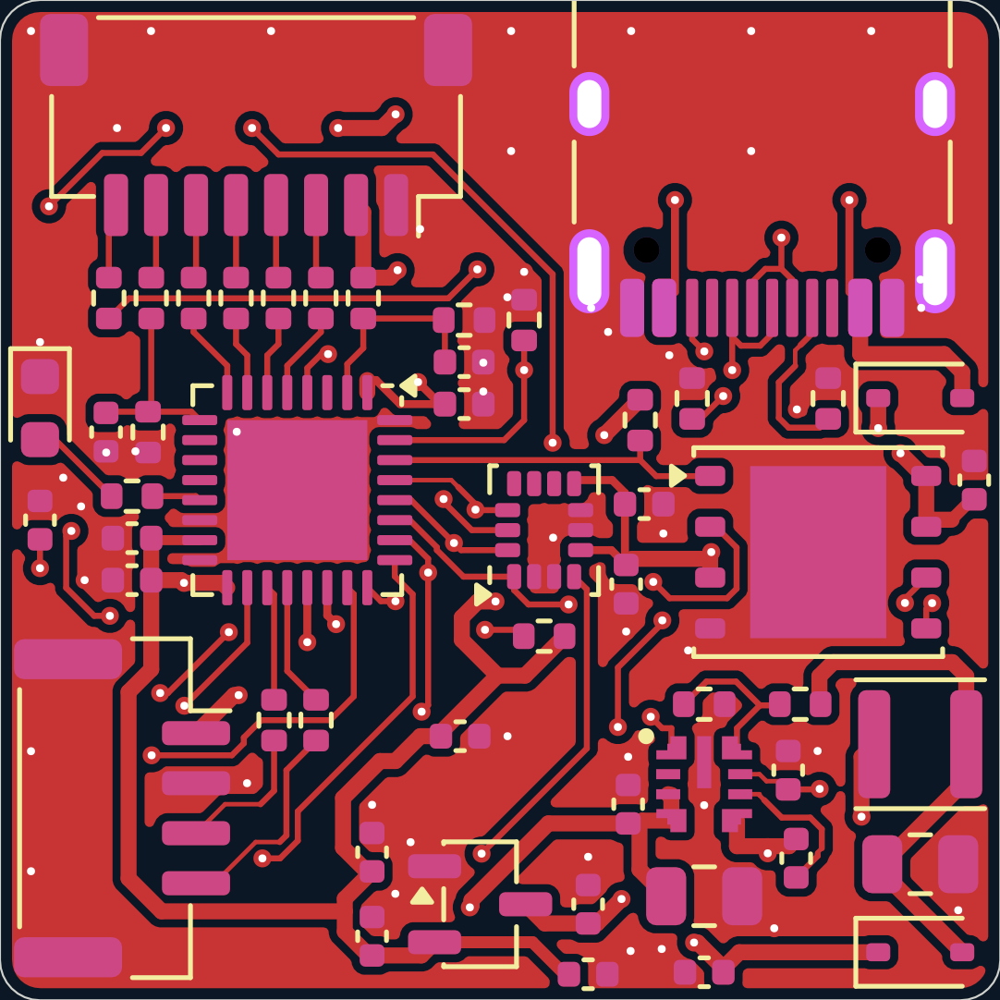
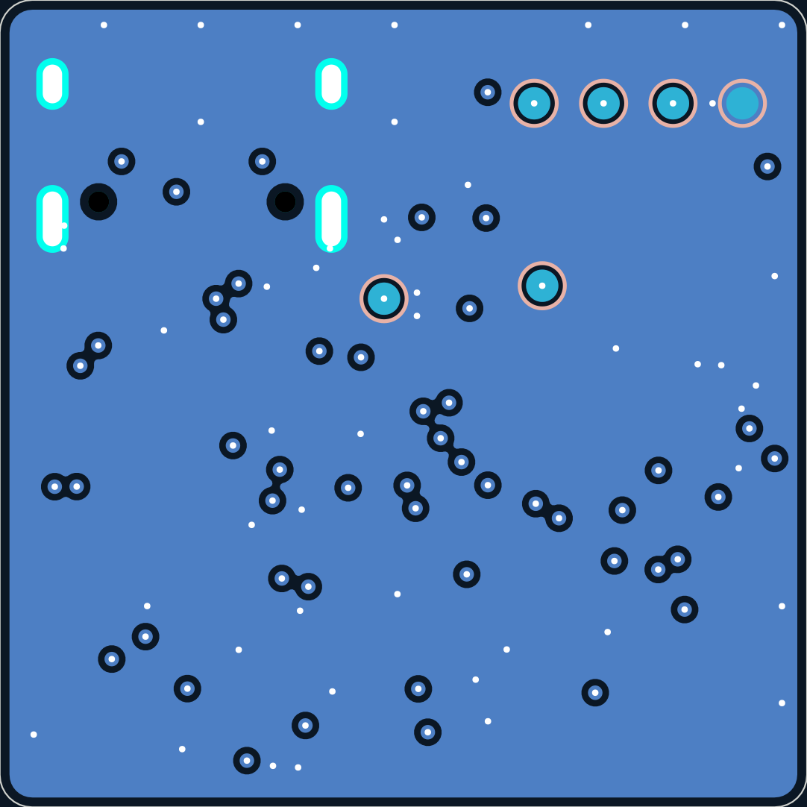
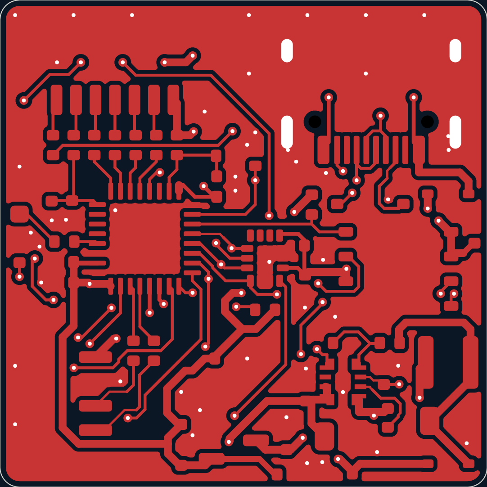
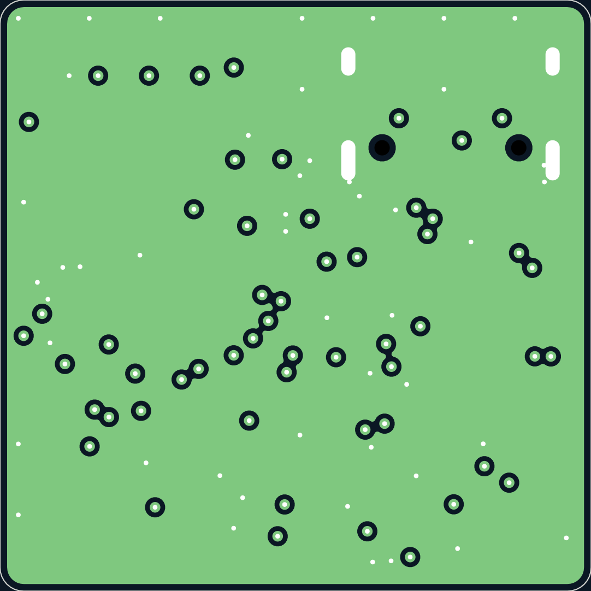
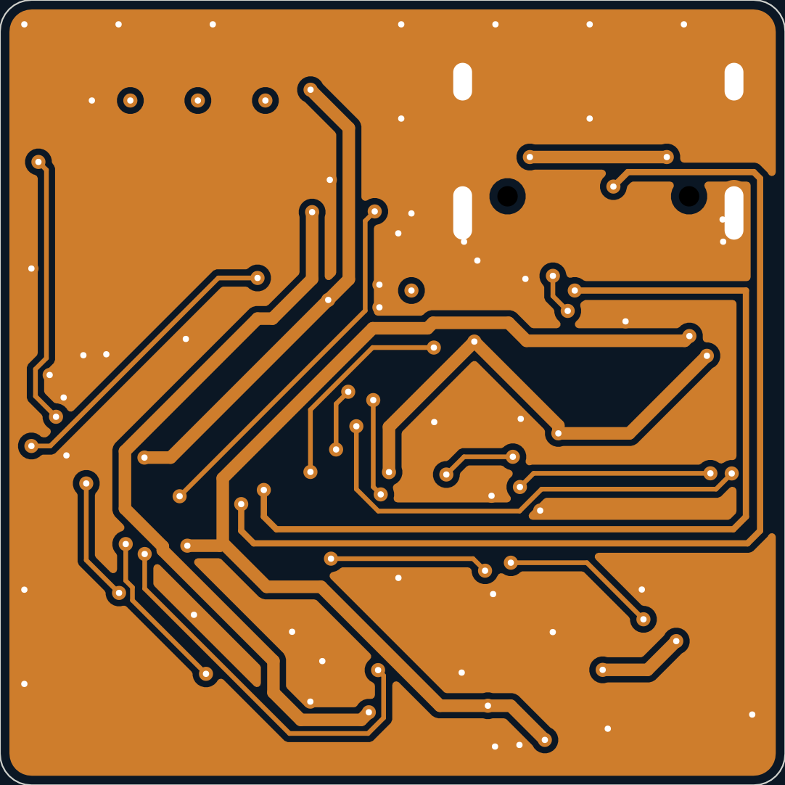
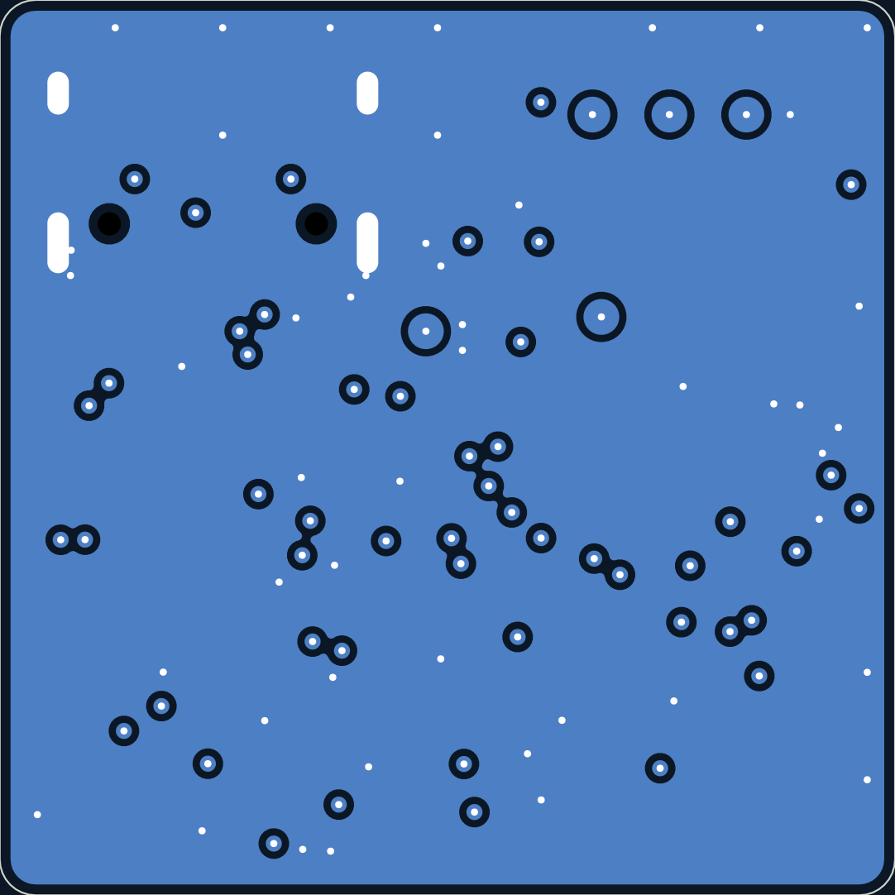
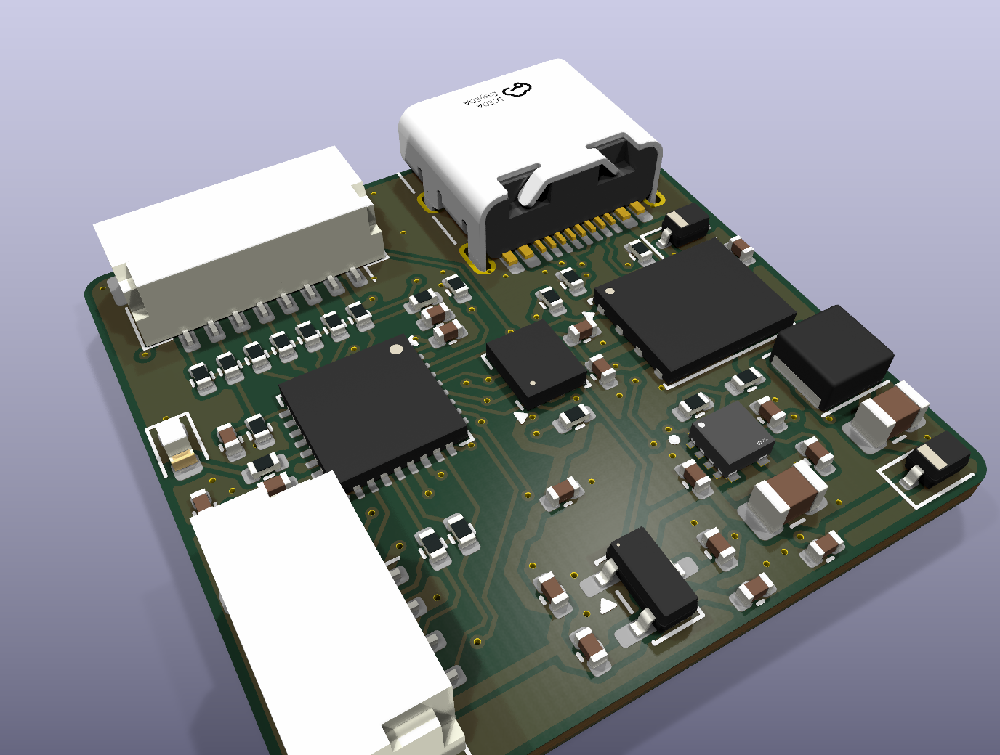

# rebot-ctrl-v2: review gate 3
_generated 2026-10-13 15:48 · checks PASS_

## Renders

## Fab files (build/fab/)
- cpl_corrections.json
- rebot-ctrl-v2-bom.csv
- rebot-ctrl-v2-cpl.csv
- rebot-ctrl-v2-gerbers.zip
- rebot-ctrl-v2.kicad_pcb

## CPL rotation corrections applied (UNVERIFIED until you check JLC's preview)
- J2 `JST_GH_SM04B-GHS-TB_1x04-1MP_P1.25mm_Horizontal`: +180° (rule `^JST_GH_SM`, community hint (unverified))
- J3 `USB_C_Receptacle_HRO_TYPE-C-31-M-12`: +0° (rule `^USB_C_Receptacle_HRO_TYPE-C-31-M-12`, confirmed)
- U3 `SOT-23-3`: +180° (rule `^SOT-23`, confirmed)
- U5 `WSON-8-1EP_6x5mm_P1.27mm_EP3.4x4.3mm`: -90° (rule `^^WSON-8-1EP_6x5mm_P1.27mm`, community hint (unverified))

Parts cost per board ≈ $19.70 + extended-part fees (8 unique extended)

## Before paying
1. Upload the gerber zip; inspect JLC's Gerber viewer (outline, cutouts, drills).
2. Upload BOM + CPL; check EVERY part's rotation/polarity in JLC's placement preview.
3. Record corrections in lib/jlc_rotations.csv (top of file), rebuild, re-upload.
4. After ordering: `git tag <board>/vX.Y` and note the order number in spec.md.
