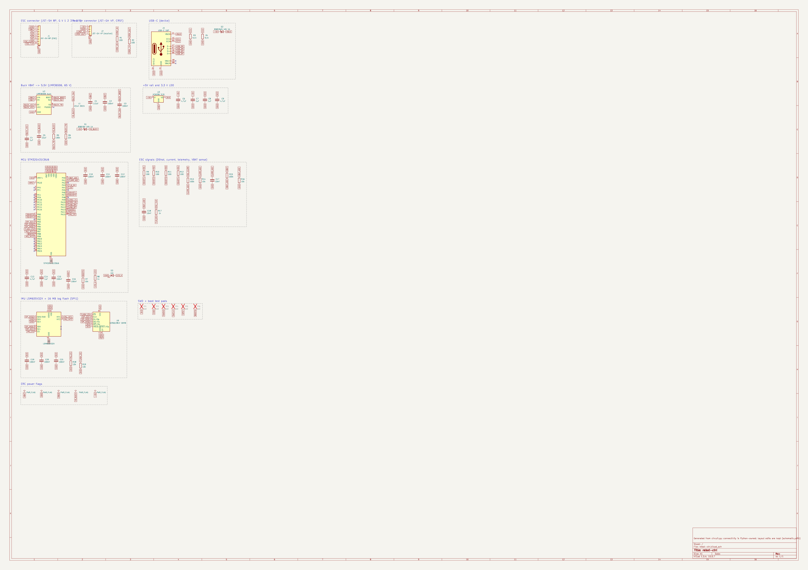

# rebot-ctrl: review gate 1
_generated 2026-10-11 19:38 · checks FAIL_

## BOM
| refs | value | MPN | LCSC | tier | stock | unit $ |
|---|---|---|---|---|---|---|
| C1 | 2.2uF | CL21A225KBQNNNE | C377773 | basic | 607,650 | 0.0367 |
| C17, C18 | 10nF | CL05B103KB5NNNC | C15195 | basic | 3,578,774 | 0.005 |
| C2, C3, C10, C11, C12, C15, C16, C19, C20, C21 | 100nF | CL05B104KB54PNC | C307331 | basic | 16,047,630 | 0.0104 |
| C4, C7, C8, C14 | 1uF | CL05A105KA5NQNC | C52923 | basic | 7,473,805 | 0.0087 |
| C5 | 22uF | CL21A226MAQNNNE | C45783 | basic | 3,684,306 | 0.2206 |
| C6, C9, C13 | 4.7uF | CL05A475MP5NRNC | C23733 | basic | 2,096,415 | 0.0167 |
| D1 | B5819W 40V 1A | B5819W SL | C8598 | basic | 400,685 | 0.0281 |
| D2 | B5819WS 40V 1A | B5819WS | C64886 | preferred | 495,390 | 0.0245 |
| D3 | red | KT-0603R | C2286 | basic | 7,258,640 | 0.0076 |
| J1 | JST-SH 8P (ESC) | SM08B-SRSS-TB(LF)(SN) | C160407 | extended | 78,598 | 0.3322 |
| J2 | JST-GH 4P (receiver) | SM04B-GHS-TB(LF)(SN) | C189895 | extended | 29,302 | 0.304 |
| J3 | USB-C 16P | TYPE-C-31-M-12 | C165948 | extended | 408,411 | 0.186 |
| L1 | 22uH 3015 | FNR3015S220MT | C167761 | extended | 36,955 | 0.0419 |
| R1, R2, R9, R10, R11, R12 | 100 | 0402WGF1000TCE | C25076 | basic | 9,215,633 | 0.0012 |
| R3, R4 | 5.1k | 0402WGF5101TCE | C25905 | basic | 5,603,466 | 0.0024 |
| R5, R13, R15 | 100k | 0402WGF1003TCE | C25741 | basic | 8,472,367 | 0.0021 |
| R6 | 22k | 0402WGF2202TCE | C25768 | basic | 738,728 | 0.0024 |
| R7, R14, R16, R18, R19 | 10k | 0402WGF1002TCE | C25744 | basic | 19,702,227 | 0.0034 |
| R8, R17 | 1k | 0402WGF1001TCE | C11702 | basic | 8,264,648 | 0.0035 |
| U1 | STM32G431CBU6 | STM32G431CBU6 | C529356 | extended | 3,591 | 7.9252 |
| U2 | LMR36506 buck | LMR36506RRPER | C2870127 | extended | 2,904 | 1.5587 |
| U3 | XC6206 3.3V | XC6206P332MR-G | C5446 | basic | 422,914 | 0.1429 |
| U4 | LSM6DSV32X | LSM6DSV32XTR | C22461202 | extended | 4,683 | 4.3617 |
| U5 | W25Q128JV 16MB | W25Q128JVPIQ | C190862 | extended | 10,357 | 3.3812 |

## Schematic (generated from circuit.py; read it next to the datasheets)

- ✓ `schematic/pins_match` all 209 symbol pins match parts.yaml
- ✓ `schematic/netlist_match` KiCad's netlist of the schematic equals circuit.py (44 nets)

## Pin tables (pad → KiCad symbol name / parts.yaml name → electrical type → net)

**J1**

| pad | symbol | ours | type | net |
|---|---|---|---|---|
| 1 | Pin_1 | 1 | passive | GND |
| 2 | Pin_2 | 2 | passive | VBAT |
| 3 | Pin_3 | 3 | passive | M1 |
| 4 | Pin_4 | 4 | passive | M2 |
| 5 | Pin_5 | 5 | passive | M3 |
| 6 | Pin_6 | 6 | passive | M4 |
| 7 | Pin_7 | 7 | passive | ESC_CURR |
| 8 | Pin_8 | 8 | passive | ESC_TLM |
| MP | MountPin | MP | passive | GND |

**J2**

| pad | symbol | ours | type | net |
|---|---|---|---|---|
| 1 | Pin_1 | 1 | passive | +5V |
| 2 | Pin_2 | 2 | passive | GND |
| 3 | Pin_3 | 3 | passive | CRSF_IN |
| 4 | Pin_4 | 4 | passive | CRSF_OUT |
| MP | MountPin | MP | passive | GND |

**R1**

| pad | symbol | ours | type | net |
|---|---|---|---|---|
| 1 | — | 1 | passive | CRSF_IN |
| 2 | — | 2 | passive | CRSF_RX |

**R2**

| pad | symbol | ours | type | net |
|---|---|---|---|---|
| 1 | — | 1 | passive | CRSF_OUT |
| 2 | — | 2 | passive | CRSF_TX |

**J3**

| pad | symbol | ours | type | net |
|---|---|---|---|---|
| A1 | GND | GND | passive | GND |
| A4 | VBUS | VBUS | passive | VBUS |
| A5 | CC1 | CC1 | bidirectional | CC1 |
| A6 | D+ | DP1 | bidirectional | USB_DP |
| A7 | D- | DN1 | bidirectional | USB_DM |
| A8 | SBU1 | SBU1 | bidirectional | NC |
| A9 | VBUS | VBUS | passive | VBUS |
| A12 | GND | GND | passive | GND |
| B1 | GND | GND | passive | GND |
| B4 | VBUS | VBUS | passive | VBUS |
| B5 | CC2 | CC2 | bidirectional | CC2 |
| B6 | D+ | DP2 | bidirectional | USB_DP |
| B7 | D- | DN2 | bidirectional | USB_DM |
| B8 | SBU2 | SBU2 | bidirectional | NC |
| B9 | VBUS | VBUS | passive | VBUS |
| B12 | GND | GND | passive | GND |
| SH | SHIELD | SHIELD | passive | GND |

**R3**

| pad | symbol | ours | type | net |
|---|---|---|---|---|
| 1 | — | 1 | passive | CC1 |
| 2 | — | 2 | passive | GND |

**R4**

| pad | symbol | ours | type | net |
|---|---|---|---|---|
| 1 | — | 1 | passive | CC2 |
| 2 | — | 2 | passive | GND |

**D2**

| pad | symbol | ours | type | net |
|---|---|---|---|---|
| 1 | K | K | passive | +5V |
| 2 | A | A | passive | VBUS |

**U2**

| pad | symbol | ours | type | net |
|---|---|---|---|---|
| 1 | RT | RT | input | BUCK_VCC |
| 2 | PGOOD | PGOOD | open_collector | NC |
| 3 | EN | EN | input | VBAT |
| 4 | VIN | VIN | power_in | VBAT |
| 5 | SW | SW | power_out | BUCK_SW |
| 6 | BOOT | BOOT | passive | BUCK_BOOT |
| 7 | VCC | VCC | power_out | BUCK_VCC |
| 8 | FB | FB | input | BUCK_FB |
| 9 | GND | GND | power_in | GND |

**L1**

| pad | symbol | ours | type | net |
|---|---|---|---|---|
| 1 | 1 | 1 | passive | BUCK_SW |
| 2 | 2 | 2 | passive | V5_BUCK |

**C1**

| pad | symbol | ours | type | net |
|---|---|---|---|---|
| 1 | — | 1 | passive | VBAT |
| 2 | — | 2 | passive | GND |

**C2**

| pad | symbol | ours | type | net |
|---|---|---|---|---|
| 1 | — | 1 | passive | VBAT |
| 2 | — | 2 | passive | GND |

**C3**

| pad | symbol | ours | type | net |
|---|---|---|---|---|
| 1 | — | 1 | passive | BUCK_BOOT |
| 2 | — | 2 | passive | BUCK_SW |

**C4**

| pad | symbol | ours | type | net |
|---|---|---|---|---|
| 1 | — | 1 | passive | BUCK_VCC |
| 2 | — | 2 | passive | GND |

**C5**

| pad | symbol | ours | type | net |
|---|---|---|---|---|
| 1 | — | 1 | passive | V5_BUCK |
| 2 | — | 2 | passive | GND |

**R5**

| pad | symbol | ours | type | net |
|---|---|---|---|---|
| 1 | — | 1 | passive | V5_BUCK |
| 2 | — | 2 | passive | BUCK_FB |

**R6**

| pad | symbol | ours | type | net |
|---|---|---|---|---|
| 1 | — | 1 | passive | BUCK_FB |
| 2 | — | 2 | passive | GND |

**D1**

| pad | symbol | ours | type | net |
|---|---|---|---|---|
| 1 | K | K | passive | +5V |
| 2 | A | A | passive | V5_BUCK |

**U3**

| pad | symbol | ours | type | net |
|---|---|---|---|---|
| 1 | GND | VSS | power_in | GND |
| 2 | VO | VOUT | power_out | 3V3 |
| 3 | VI | VIN | power_in | +5V |

**C6**

| pad | symbol | ours | type | net |
|---|---|---|---|---|
| 1 | — | 1 | passive | +5V |
| 2 | — | 2 | passive | GND |

**C7**

| pad | symbol | ours | type | net |
|---|---|---|---|---|
| 1 | — | 1 | passive | +5V |
| 2 | — | 2 | passive | GND |

**C8**

| pad | symbol | ours | type | net |
|---|---|---|---|---|
| 1 | — | 1 | passive | 3V3 |
| 2 | — | 2 | passive | GND |

**C9**

| pad | symbol | ours | type | net |
|---|---|---|---|---|
| 1 | — | 1 | passive | 3V3 |
| 2 | — | 2 | passive | GND |

**U1**

| pad | symbol | ours | type | net |
|---|---|---|---|---|
| 1 | VBAT | VBAT | power_in | 3V3 |
| 2 | PC13 | PC13 | bidirectional | NC |
| 3 | PC14 | PC14 | bidirectional | NC |
| 4 | PC15 | PC15 | bidirectional | NC |
| 5 | PF0 | PF0 | bidirectional | NC |
| 6 | PF1 | PF1 | bidirectional | NC |
| 7 | PG10 | PG10 | bidirectional | NRST |
| 8 | PA0 | PA0 | bidirectional | VBAT_ADC |
| 9 | PA1 | PA1 | bidirectional | CURR_ADC |
| 10 | PA2 | PA2 | bidirectional | NC |
| 11 | PA3 | PA3 | bidirectional | TLM_RX |
| 12 | PA4 | PA4 | bidirectional | LED |
| 13 | PA5 | PA5 | bidirectional | NC |
| 14 | PA6 | PA6 | bidirectional | DSHOT1 |
| 15 | PA7 | PA7 | bidirectional | DSHOT2 |
| 16 | PC4 | PC4 | bidirectional | NC |
| 17 | PB0 | PB0 | bidirectional | DSHOT3 |
| 18 | PB1 | PB1 | bidirectional | DSHOT4 |
| 19 | PB2 | PB2 | bidirectional | NC |
| 20 | VREF+ | VREF+ | input | 3V3 |
| 21 | VDDA | VDDA | power_in | 3V3 |
| 22 | PB10 | PB10 | bidirectional | NC |
| 23 | VDD | VDD | power_in | 3V3 |
| 24 | PB11 | PB11 | bidirectional | NC |
| 25 | PB12 | PB12 | bidirectional | NC |
| 26 | PB13 | PB13 | bidirectional | NC |
| 27 | PB14 | PB14 | bidirectional | NC |
| 28 | PB15 | PB15 | bidirectional | NC |
| 29 | PC6 | PC6 | bidirectional | NC |
| 30 | PA8 | PA8 | bidirectional | NC |
| 31 | PA9 | PA9 | bidirectional | CRSF_TX |
| 32 | PA10 | PA10 | bidirectional | CRSF_RX |
| 33 | PA11 | PA11 | bidirectional | USB_DM |
| 34 | PA12 | PA12 | bidirectional | USB_DP |
| 35 | VDD | VDD | power_in | 3V3 |
| 36 | PA13 | PA13 | bidirectional | SWDIO |
| 37 | PA14 | PA14 | bidirectional | SWCLK |
| 38 | PA15 | PA15 | bidirectional | IMU_CS |
| 39 | PC10 | PC10 | bidirectional | NC |
| 40 | PC11 | PC11 | bidirectional | NC |
| 41 | PB3 | PB3 | bidirectional | SPI_SCK |
| 42 | PB4 | PB4 | bidirectional | SPI_MISO |
| 43 | PB5 | PB5 | bidirectional | SPI_MOSI |
| 44 | PB6 | PB6 | bidirectional | FLASH_CS |
| 45 | PB7 | PB7 | bidirectional | IMU_INT1 |
| 46 | PB8 | PB8 | bidirectional | BOOT0 |
| 47 | PB9 | PB9 | bidirectional | IMU_INT2 |
| 48 | VDD | VDD | power_in | 3V3 |
| 49 | VSS | VSS | power_in | GND |

**C10**

| pad | symbol | ours | type | net |
|---|---|---|---|---|
| 1 | — | 1 | passive | 3V3 |
| 2 | — | 2 | passive | GND |

**C11**

| pad | symbol | ours | type | net |
|---|---|---|---|---|
| 1 | — | 1 | passive | 3V3 |
| 2 | — | 2 | passive | GND |

**C12**

| pad | symbol | ours | type | net |
|---|---|---|---|---|
| 1 | — | 1 | passive | 3V3 |
| 2 | — | 2 | passive | GND |

**C13**

| pad | symbol | ours | type | net |
|---|---|---|---|---|
| 1 | — | 1 | passive | 3V3 |
| 2 | — | 2 | passive | GND |

**C14**

| pad | symbol | ours | type | net |
|---|---|---|---|---|
| 1 | — | 1 | passive | 3V3 |
| 2 | — | 2 | passive | GND |

**C15**

| pad | symbol | ours | type | net |
|---|---|---|---|---|
| 1 | — | 1 | passive | 3V3 |
| 2 | — | 2 | passive | GND |

**C16**

| pad | symbol | ours | type | net |
|---|---|---|---|---|
| 1 | — | 1 | passive | NRST |
| 2 | — | 2 | passive | GND |

**R7**

| pad | symbol | ours | type | net |
|---|---|---|---|---|
| 1 | — | 1 | passive | BOOT0 |
| 2 | — | 2 | passive | GND |

**R8**

| pad | symbol | ours | type | net |
|---|---|---|---|---|
| 1 | — | 1 | passive | LED |
| 2 | — | 2 | passive | LED_A |

**D3**

| pad | symbol | ours | type | net |
|---|---|---|---|---|
| 1 | K | K | passive | GND |
| 2 | A | A | passive | LED_A |

**R9**

| pad | symbol | ours | type | net |
|---|---|---|---|---|
| 1 | — | 1 | passive | M1 |
| 2 | — | 2 | passive | DSHOT1 |

**R10**

| pad | symbol | ours | type | net |
|---|---|---|---|---|
| 1 | — | 1 | passive | M2 |
| 2 | — | 2 | passive | DSHOT2 |

**R11**

| pad | symbol | ours | type | net |
|---|---|---|---|---|
| 1 | — | 1 | passive | M3 |
| 2 | — | 2 | passive | DSHOT3 |

**R12**

| pad | symbol | ours | type | net |
|---|---|---|---|---|
| 1 | — | 1 | passive | M4 |
| 2 | — | 2 | passive | DSHOT4 |

**R13**

| pad | symbol | ours | type | net |
|---|---|---|---|---|
| 1 | — | 1 | passive | ESC_CURR |
| 2 | — | 2 | passive | CURR_ADC |

**R14**

| pad | symbol | ours | type | net |
|---|---|---|---|---|
| 1 | — | 1 | passive | CURR_ADC |
| 2 | — | 2 | passive | GND |

**C17**

| pad | symbol | ours | type | net |
|---|---|---|---|---|
| 1 | — | 1 | passive | CURR_ADC |
| 2 | — | 2 | passive | GND |

**R15**

| pad | symbol | ours | type | net |
|---|---|---|---|---|
| 1 | — | 1 | passive | VBAT |
| 2 | — | 2 | passive | VBAT_ADC |

**R16**

| pad | symbol | ours | type | net |
|---|---|---|---|---|
| 1 | — | 1 | passive | VBAT_ADC |
| 2 | — | 2 | passive | GND |

**C18**

| pad | symbol | ours | type | net |
|---|---|---|---|---|
| 1 | — | 1 | passive | VBAT_ADC |
| 2 | — | 2 | passive | GND |

**R17**

| pad | symbol | ours | type | net |
|---|---|---|---|---|
| 1 | — | 1 | passive | ESC_TLM |
| 2 | — | 2 | passive | TLM_RX |

**U4**

| pad | symbol | ours | type | net |
|---|---|---|---|---|
| 1 | SDO/SA0 | SDO | bidirectional | SPI_MISO |
| 2 | SDX | SDX | bidirectional | GND |
| 3 | SCX | SCX | input | GND |
| 4 | INT1 | INT1 | output | IMU_INT1 |
| 5 | VDDIO | VDDIO | power_in | 3V3 |
| 6 | GND | GND | power_in | GND |
| 7 | GND | GND | passive | GND |
| 8 | VDD | VDD | power_in | 3V3 |
| 9 | INT2 | INT2 | output | IMU_INT2 |
| 10 | NC | NC | no_connect | NC |
| 11 | NC | NC | no_connect | NC |
| 12 | CS | CS | input | IMU_CS |
| 13 | SCL | SCL | input | SPI_SCK |
| 14 | SDA | SDA | bidirectional | SPI_MOSI |

**U5**

| pad | symbol | ours | type | net |
|---|---|---|---|---|
| 1 | ~{CS} | CS | input | FLASH_CS |
| 2 | DO/IO_{1} | DO | bidirectional | SPI_MISO |
| 3 | ~{WP}/IO_{2} | WP | bidirectional | 3V3 |
| 4 | GND | GND | power_in | GND |
| 5 | DI/IO_{0} | DI | bidirectional | SPI_MOSI |
| 6 | CLK | CLK | input | SPI_SCK |
| 7 | ~{HOLD}/~{RESET}/IO_{3} | HOLD | bidirectional | 3V3 |
| 8 | VCC | VCC | power_in | 3V3 |
| 9 | EP | EP | passive | GND |

**C19**

| pad | symbol | ours | type | net |
|---|---|---|---|---|
| 1 | — | 1 | passive | 3V3 |
| 2 | — | 2 | passive | GND |

**C20**

| pad | symbol | ours | type | net |
|---|---|---|---|---|
| 1 | — | 1 | passive | 3V3 |
| 2 | — | 2 | passive | GND |

**C21**

| pad | symbol | ours | type | net |
|---|---|---|---|---|
| 1 | — | 1 | passive | 3V3 |
| 2 | — | 2 | passive | GND |

**R18**

| pad | symbol | ours | type | net |
|---|---|---|---|---|
| 1 | — | 1 | passive | IMU_CS |
| 2 | — | 2 | passive | 3V3 |

**R19**

| pad | symbol | ours | type | net |
|---|---|---|---|---|
| 1 | — | 1 | passive | FLASH_CS |
| 2 | — | 2 | passive | 3V3 |

**TP1**

| pad | symbol | ours | type | net |
|---|---|---|---|---|
| 1 | 1 | 1 | passive | 3V3 |

**TP2**

| pad | symbol | ours | type | net |
|---|---|---|---|---|
| 1 | 1 | 1 | passive | GND |

**TP3**

| pad | symbol | ours | type | net |
|---|---|---|---|---|
| 1 | 1 | 1 | passive | SWDIO |

**TP4**

| pad | symbol | ours | type | net |
|---|---|---|---|---|
| 1 | 1 | 1 | passive | SWCLK |

**TP5**

| pad | symbol | ours | type | net |
|---|---|---|---|---|
| 1 | 1 | 1 | passive | NRST |

**TP6**

| pad | symbol | ours | type | net |
|---|---|---|---|---|
| 1 | 1 | 1 | passive | BOOT0 |

## Pinout evidence (ICs and connectors)
- **J1** SM08B-SRSS-TB (C160407): connector: pin n = pad n (JST SH SM08B, KiCad stock footprint); signal order matches the FPV 4-in-1 cable, see rebot-ctrl spec — verified 2026-10-11
  - pin map: 1=1, 2=2, 3=3, 4=4, 5=5, 6=6, 7=7, 8=8, MP=MP
- **J2** SM04B-GHS-TB (C189895): connector: pin n = pad n (JST GH SM04B, KiCad stock footprint) — verified 2026-10-11
  - pin map: 1=1, 2=2, 3=3, 4=4, MP=MP
- **J3** TYPE-C-31-M-12 (C165948): USB Type-C spec pin names; KiCad footprint is specific to this exact part (HRO TYPE-C-31-M-12), pads named by spec pin — verified 2026-10-11
  - pin map: GND=A1/A12/B1/B12, VBUS=A4/A9/B4/B9, CC1=A5, CC2=B5, DP1=A6, DN1=A7, DP2=B6, DN2=B7, SBU1=A8, SBU2=B8, SHIELD=SH
- **D2** B5819WS (C64886): two-terminal diode; KiCad SOD-323 pad 1 = cathode (band), symbol pin 1 = K — verified 2026-10-11
  - pin map: K=1, A=2
  - note: JLC Preferred (no setup fee). 40 V, 1 A. Smaller sibling of B5819W SL for tight spots. Check the cathode band in JLC's preview.
- **U2** LMR36506RRPER (C2870127): TI LMR36506 ZHCSKN9B (rev. Dec 2022) p.4 fig.6-1 (FB variant, right) + table 6-1; RRPER = adjustable output, RT, PFM (p.3 device comparison) — verified 2026-10-11
  - pin map: RT=1, PGOOD=2, EN=3, VIN=4, SW=5, BOOT=6, VCC=7, FB=8, GND=9
  - note: Vin 3.6-65 V, 0.6 A. VREF 1.0 V: VOUT = 1 + RFBT/RFBB (RFBT 100k recommended). RT to VCC = 1 MHz, to GND = 2.2 MHz (table 8-1). Required: CIN 2.2 uF + 100 nF HF at VIN, CBOOT 100 nF BOOT-SW, CVCC 1 uF VCC-GND (VCC: no external loads). EN may tie to VIN. PGOOD open-drain, may float or ground. Footprint: EasyEDA geometry checked against TI land pattern p.52.
- **L1** FNR3015S220MT (C167761): two-terminal inductor, unpolarized; KiCad stock footprint for this exact series — verified 2026-10-11
  - pin map: 1=1, 2=2
  - note: Changjiang FNR3015S 22 uH +-20%, Isat 680 mA, DCR 598 mOhm, 3x3x1.5 mm shielded. Ripple at 24 V in / 11 V out / 1 MHz = 0.27 A p-p.
- **D1** B5819W_SL (C8598): two-terminal diode; KiCad SOD-123 pad 1 = cathode (band), symbol pin 1 = K — verified 2026-10-11
  - pin map: K=1, A=2
  - note: Basic. 40 V, 1 A, Vf ~0.35 V at 0.25 A. Check the cathode band in JLC's placement preview.
- **U3** XC6206P332MR-G (C5446): Torex ETR0305_004b p.2 PIN ASSIGNMENT, SOT-23 column (1=VSS, 2=VOUT, 3=VIN) — verified 2026-10-11
  - pin map: VSS=1, VOUT=2, VIN=3
  - note: Torex original. Clones (e.g. UMW XC6206P332MR) are documented with different pin orders, so never substitute without re-checking. Vin max 6.0V operating.
- **U1** STM32G431CBU6 (C529356): ST DS12589 Rev 2 p.45 fig.7 UFQFPN48 pinout (VSS only on the exposed pad); AF table 13 p.61 (port A); KiCad STM32G431CBUx symbol agrees pin for pin — verified 2026-10-11
  - pin map: VBAT=1, PC13=2, PC14=3, PC15=4, PF0=5, PF1=6, PG10=7, PA0=8, PA1=9, PA2=10, PA3=11, PA4=12, PA5=13, PA6=14, PA7=15, PC4=16, PB0=17, PB1=18, PB2=19, VREF+=20, VDDA=21, PB10=22, VDD=23/35/48, PB11=24, PB12=25, PB13=26, PB14=27, PB15=28, PC6=29, PA8=30, PA9=31, PA10=32, PA11=33, PA12=34, PA13=36, PA14=37, PA15=38, PC10=39, PC11=40, PB3=41, PB4=42, PB5=43, PB6=44, PB7=45, PB8=46, PB9=47, VSS=49
  - note: PG10 = NRST (internal pull-up, 100 nF to GND), PB8 = BOOT0 (10k pull-down). PA11/PA12 are USB DM/DP only (no USART there). USB clock from HSI48 + CRS, no crystal needed. Used AFs: TIM3_CH1-4 = PA6/PA7/PB0/PB1 (AF2), USART1 TX/RX = PA9/PA10 (AF7), USART2_RX = PA3 (AF7), SPI1 SCK/MISO/MOSI = PB3/PB4/PB5 (AF5). PA0/PA1 = ADC12_IN1/IN2.
- **U4** LSM6DSV32XTR (C22461202): ST LSM6DSV32X DS13511 Rev 2 p.11 table 2 (pin description); same LGA-14 2.5x3 pinout as the LSM6DSL symbol — verified 2026-10-11
  - pin map: SDO=1, SDX=2, SCX=3, INT1=4, VDDIO=5, GND=6/7, VDD=8, INT2=9, NC=10/11, CS=12, SCL=13, SDA=14
  - note: SPI mode: CS low = SPI. Pins 2/3 (SDx/SCx) must go to VDD_IO or GND when the analog hub/Qvar is unused; 10/11 (OCS_Aux/SDO_Aux) may be left unconnected (soldered). 100 nF on VDD and VDD_IO.
- **U5** W25Q128JVPIQ (C190862): Winbond W25Q128JV datasheet p.5 fig.1b WSON 6x5 pad assignment + table 3.3; KiCad W25Q128JVP symbol agrees — verified 2026-10-11
  - pin map: CS=1, DO=2, WP=3, GND=4, DI=5, CLK=6, HOLD=7, VCC=8, EP=9
  - note: 2.7-3.6 V. /WP and /HOLD tied high for standard SPI. Exposed pad: GND.
- **TP1** TestPoint_1mm (None): single test pad — verified 2026-10-11
  - pin map: 1=1
- **TP2** TestPoint_1mm (None): single test pad — verified 2026-10-11
  - pin map: 1=1
- **TP3** TestPoint_1mm (None): single test pad — verified 2026-10-11
  - pin map: 1=1
- **TP4** TestPoint_1mm (None): single test pad — verified 2026-10-11
  - pin map: 1=1
- **TP5** TestPoint_1mm (None): single test pad — verified 2026-10-11
  - pin map: 1=1
- **TP6** TestPoint_1mm (None): single test pad — verified 2026-10-11
  - pin map: 1=1

## Design assertions
- ✓ Buck Vin: spike budget vs LMR36506 65 V: 40 V (allowed 0 … 58.5)
- ✓ Buck output (RFBT 100k / RFBB 22k): 5.545 V (allowed 5.3 … 5.8)
- ✓ +5V rail after the OR diode (receiver supply): 5.195 V (allowed 4.75 … 5.5)
- ✓ +5V vs XC6206 6.0 V max input: 5.545 V (allowed 0 … 6)
- ✓ XC6206 headroom (dropout ~0.25 V @ 100 mA): 1.895 V (allowed 0.4 … 3)
- ✓ XC6206 dissipation (SOT-23 ~0.25 W): 0.1516 W (allowed 0 … 0.25)
- ✓ +5V load: receiver 0.3 A + 3V3 rail vs LMR36506 0.6 A: 0.38 A (allowed 0 … 0.6)
- ✓ Buck inductor peak (24 V in, 0.4 A load) vs Isat 0.68 A: 0.4969 A (allowed 0 … 0.612)
- ✓ VBAT_ADC at full LiHV (100k/10k): 2.373 V (allowed 0 … 3.3)
- ✓ CURR_ADC if the ESC cable is reversed (VBAT on CURR): 2.373 V (allowed 0 … 3.3)
- ✓ ESC current signal 3.3 V -> ADC counts after /11 (12-bit): 372.3 counts (allowed 300 … 4095)
- ✓ Status LED current (Vf 1.8-2.4 V): 0.0014 A (allowed 0.0005 … 0.005)

## Nets
- `GND` (Power): J1.1, J1.MP, J2.2, J2.MP, J3.GND, J3.SHIELD, R3.2, R4.2, U2.GND, C1.2, C2.2, C4.2, C5.2, R6.2, U3.VSS, C6.2, C7.2, C8.2, C9.2, U1.VSS, C10.2, C11.2, C12.2, C13.2, C14.2, C15.2, C16.2, R7.2, D3.K, R14.2, C17.2, R16.2, C18.2, U4.GND, U4.SDX, U4.SCX, U5.GND, U5.EP, C19.2, C20.2, C21.2, TP2.1
- `VBAT` (Power): J1.2, U2.VIN, U2.EN, C1.1, C2.1, R15.1
- `M1` (Default): J1.3, R9.1
- `M2` (Default): J1.4, R10.1
- `M3` (Default): J1.5, R11.1
- `M4` (Default): J1.6, R12.1
- `ESC_CURR` (Default): J1.7, R13.1
- `ESC_TLM` (Default): J1.8, R17.1
- `+5V` (Power): J2.1, D1.K, D2.K, C6.1, U3.VIN, C7.1
- `CRSF_IN` (Default): J2.3, R1.1
- `CRSF_OUT` (Default): J2.4, R2.1
- `VBUS` (Power): J3.VBUS, D2.A
- `CC1` (Default): J3.CC1, R3.1
- `CC2` (Default): J3.CC2, R4.1
- `USB_DP` (Default): J3.DP1, J3.DP2, U1.PA12
- `USB_DM` (Default): J3.DN1, J3.DN2, U1.PA11
- `BUCK_VCC` (Default): U2.VCC, U2.RT, C4.1
- `BUCK_SW` (Power): U2.SW, L1.1, C3.2
- `BUCK_BOOT` (Default): U2.BOOT, C3.1
- `V5_BUCK` (Power): L1.2, C5.1, R5.1, D1.A
- `BUCK_FB` (Default): U2.FB, R5.2, R6.1
- `3V3` (Power): U3.VOUT, C8.1, C9.1, U1.VDD, U1.VBAT, U1.VDDA, U1.VREF+, C10.1, C11.1, C12.1, C13.1, C14.1, C15.1, U4.VDD, U4.VDDIO, U5.VCC, U5.WP, U5.HOLD, C19.1, C20.1, C21.1, R18.2, R19.2, TP1.1
- `NRST` (Default): U1.PG10, C16.1, TP5.1
- `BOOT0` (Default): U1.PB8, R7.1, TP6.1
- `LED` (Default): U1.PA4, R8.1
- `LED_A` (Default): R8.2, D3.A
- `SWDIO` (Default): U1.PA13, TP3.1
- `SWCLK` (Default): U1.PA14, TP4.1
- `CRSF_RX` (Default): R1.2, U1.PA10
- `CRSF_TX` (Default): R2.2, U1.PA9
- `DSHOT1` (Default): R9.2, U1.PA6
- `DSHOT2` (Default): R10.2, U1.PA7
- `DSHOT3` (Default): R11.2, U1.PB0
- `DSHOT4` (Default): R12.2, U1.PB1
- `CURR_ADC` (Default): R13.2, R14.1, C17.1, U1.PA1
- `VBAT_ADC` (Default): R15.2, R16.1, C18.1, U1.PA0
- `TLM_RX` (Default): R17.2, U1.PA3
- `SPI_SCK` (Default): U1.PB3, U4.SCL, U5.CLK
- `SPI_MISO` (Default): U1.PB4, U4.SDO, U5.DO
- `SPI_MOSI` (Default): U1.PB5, U4.SDA, U5.DI
- `IMU_CS` (Default): U1.PA15, U4.CS, R18.1
- `FLASH_CS` (Default): U1.PB6, U5.CS, R19.1
- `IMU_INT1` (Default): U1.PB7, U4.INT1
- `IMU_INT2` (Default): U1.PB9, U4.INT2
- NC: J3.SBU1, J3.SBU2, U1.PA2, U1.PA5, U1.PA8, U1.PB10, U1.PB11, U1.PB12, U1.PB13, U1.PB14, U1.PB15, U1.PB2, U1.PC10, U1.PC11, U1.PC13, U1.PC14, U1.PC15, U1.PC4, U1.PC6, U1.PF0, U1.PF1, U2.PGOOD, U4.NC
