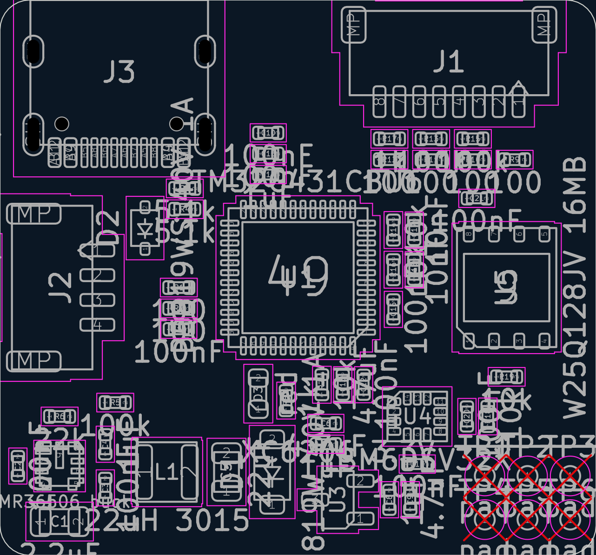
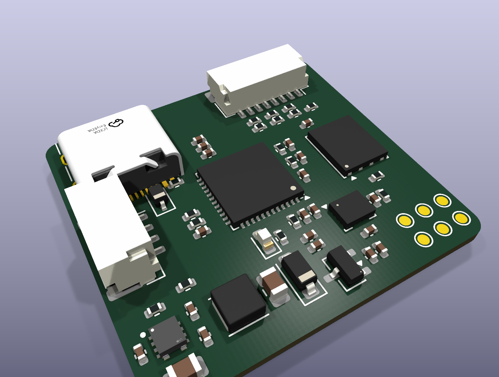
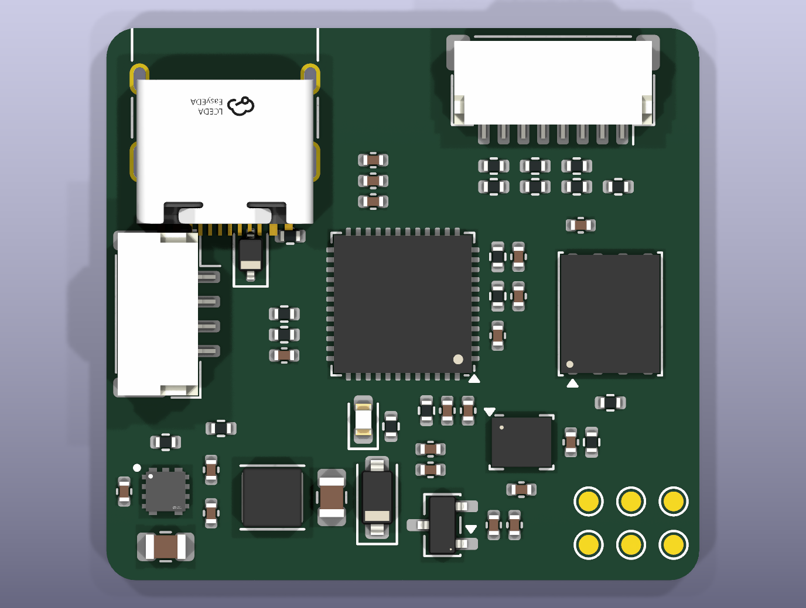
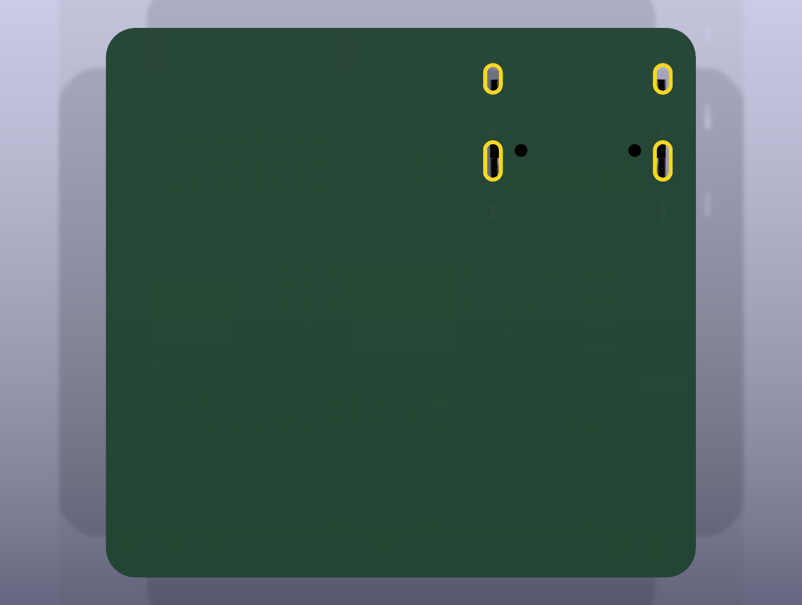

# rebot-ctrl: review gate 2
_generated 2026-10-11 19:38 · checks FAIL_

## Renders

## Placement rules
- ✓ C10 -> U1 pad 23: 3.87 mm (max 4.4) — MCU VDD (pin 23) decoupling
- ✓ C11 -> U1 pad 35: 2.11 mm (max 2.6) — MCU VDD (pin 35) decoupling
- ✓ C12 -> U1 pad 48: 1.58 mm (max 2.1) — MCU VDD (pin 48) decoupling
- ✓ C15 -> U1 pad 21: 2.82 mm (max 3.3) — VDDA HF decoupling
- ✓ C14 -> U1 pad 21: 1.78 mm (max 2.3) — VDDA bulk
- ✓ C16 -> U1 pad 7: 1.93 mm (max 2.4) — NRST cap
- ✓ R7 -> U1 pad 46: 1.55 mm (max 2.1) — BOOT0 pull-down
- ✓ R14 -> U1 pad 9: 1.50 mm (max 2.0) — CURR divider at PA1
- ✓ C17 -> U1 pad 9: 2.50 mm (max 3.0) — CURR filter at PA1
- ✓ R16 -> U1 pad 8: 1.37 mm (max 1.9) — VBAT divider at PA0
- ✓ C18 -> U1 pad 8: 2.42 mm (max 2.9) — VBAT filter at PA0
- ✓ R1 -> U1 pad 32: 2.07 mm (max 2.6) — CRSF RX series (PA10)
- ✓ R2 -> U1 pad 31: 2.43 mm (max 2.9) — CRSF TX series (PA9)
- ✓ C19 -> U4 pad 8: 1.79 mm (max 2.3) — IMU VDD decoupling
- ✓ C21 -> U5 pad 8: 1.80 mm (max 2.3) — flash VCC decoupling
- ✓ C2 -> U2 pad 4: 1.35 mm (max 1.9) — buck VIN HF
- ✓ C1 -> U2 pad 4: 1.89 mm (max 2.4) — buck VIN bulk
- ✓ C3 -> U2 pad 6: 1.45 mm (max 1.9) — buck BOOT
- ✓ C4 -> U2 pad 7: 1.45 mm (max 1.9) — buck VCC
- ✓ R6 -> U2 pad 8: 1.62 mm (max 2.1) — buck FB divider
- ✓ L1 -> U2 pad 5: 3.48 mm (max 4.0) — buck inductor at SW
- ✓ C7 -> U3 pad 3: 2.80 mm (max 3.3) — LDO input cap at VIN (pad 3)
- ✓ C8 -> U3 pad 2: 1.54 mm (max 2.0) — LDO output cap at VOUT (pad 2)
- ✓ J1 courtyard -0.18 mm from top edge — ESC cable plugs in from the top edge
- ✓ J3 courtyard -0.52 mm from top edge — USB-C mouth at the top edge (reachable with the lid off)
- ✓ J2 courtyard -0.17 mm from left edge — receiver cable comes from the robot left side

## Placement intent (from placement.yaml)
- J3: {'at': [6.0, 3.65], 'rot': 180}
- J1: {'at': [22.6, 3.125], 'rot': 180}
- J2: {'at': [3.05, 14.5], 'rot': 270}
- U1: {'at': [15.0, 14.0], 'rot': 180}
- C10: {'at': [13.5, 6.7], 'rot': 0}
- C15: {'at': [13.5, 7.75], 'rot': 0}
- C14: {'at': [13.5, 8.8], 'rot': 0}
- C11: {'at': [9.0, 16.6], 'rot': 0}
- C12: {'at': [18.3, 19.4], 'rot': 90}
- C13: {'at': [17.25, 19.4], 'rot': 90}
- R7: {'at': [16.2, 19.4], 'rot': 90}
- C16: {'at': [19.8, 15.6], 'rot': 90}
- D3: {'at': [13.0, 19.85], 'rot': 90}
- R8: {'at': [14.4, 20.2], 'rot': 90}
- R17: {'at': [19.6, 7.0], 'rot': 0}
- R13: {'at': [21.7, 7.0], 'rot': 0}
- R15: {'at': [23.8, 7.0], 'rot': 0}
- R12: {'at': [19.6, 8.05], 'rot': 0}
- R11: {'at': [21.7, 8.05], 'rot': 0}
- R10: {'at': [23.8, 8.05], 'rot': 0}
- R9: {'at': [25.9, 8.05], 'rot': 0}
- R14: {'at': [19.8, 11.6], 'rot': 90}
- C17: {'at': [20.85, 11.6], 'rot': 90}
- R16: {'at': [19.8, 13.6], 'rot': 90}
- C18: {'at': [20.85, 13.6], 'rot': 90}
- D2: {'at': [7.3, 11.5], 'rot': 90}
- R3: {'at': [9.3, 9.5], 'rot': 0}
- R4: {'at': [9.3, 10.55], 'rot': 0}
- R1: {'at': [9.0, 14.5], 'rot': 0}
- R2: {'at': [9.0, 15.55], 'rot': 0}
- U5: {'at': [25.5, 14.5], 'rot': 90}
- C21: {'at': [24.0, 10.0], 'rot': 0}
- R19: {'at': [25.5, 19.0], 'rot': 0}
- U4: {'at': [21.0, 21.0], 'rot': 0}
- C19: {'at': [21.0, 23.4], 'rot': 0}
- C20: {'at': [23.5, 21.0], 'rot': 90}
- R18: {'at': [24.55, 21.0], 'rot': 90}
- U2: {'at': [3.0, 23.5], 'rot': 0}
- C2: {'at': [0.9, 23.5], 'rot': 90}
- C1: {'at': [3.0, 26.3], 'rot': 0}
- R6: {'at': [3.0, 21.0], 'rot': 0}
- R5: {'at': [5.8, 20.3], 'rot': 0}
- C4: {'at': [5.3, 22.4], 'rot': 90}
- C3: {'at': [5.3, 24.6], 'rot': 90}
- L1: {'at': [8.4, 23.8], 'rot': 0}
- C5: {'at': [11.4, 23.8], 'rot': 90}
- D1: {'at': [13.7, 23.8], 'rot': 90}
- U3: {'at': [17.0, 25.2], 'rot': 180}
- C6: {'at': [16.4, 21.35], 'rot': 0}
- C7: {'at': [16.4, 22.4], 'rot': 0}
- C8: {'at': [19.6, 25.2], 'rot': 90}
- C9: {'at': [20.65, 25.2], 'rot': 90}
- TP1: {'at': [24.4, 24.0]}
- TP2: {'at': [26.55, 24.0]}
- TP3: {'at': [28.7, 24.0]}
- TP4: {'at': [24.4, 26.2]}
- TP5: {'at': [26.55, 26.2]}
- TP6: {'at': [28.7, 26.2]}
