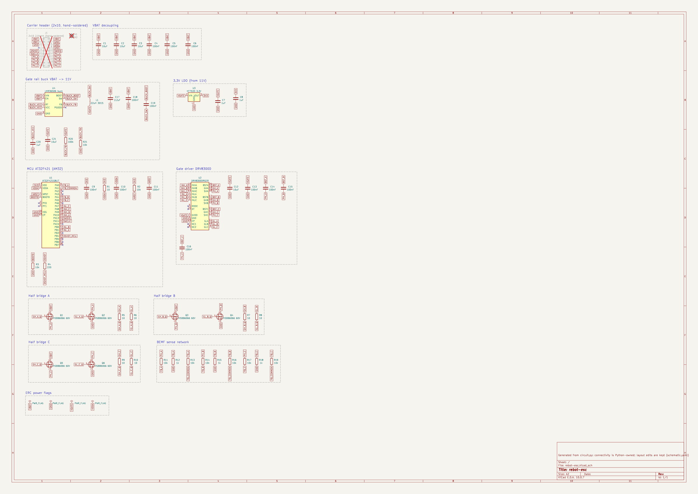

# rebot-esc: review gate 1
_generated 2026-10-11 16:55 · checks FAIL_

## BOM
| refs | value | MPN | LCSC | tier | stock | unit $ |
|---|---|---|---|---|---|---|
| C1, C2, C3 | 10uF | GRM21BR61H106KE43L | C440198 | basic | 1,367,301 | 0.2069 |
| C17 | 2.2uF | CL21A225KBQNNNE | C377773 | basic | 607,650 | 0.0367 |
| C20, C8 | 1uF | CL05A105KA5NQNC | C52923 | basic | 7,473,805 | 0.0087 |
| C21, C12 | 10uF | CL21A106KAYNNNE | C15850 | basic | 4,303,759 | 0.0688 |
| C4, C5, C6, C18, C19, C9, C10, C11, C13, C14, C15, C16 | 100nF | CL05B104KB54PNC | C307331 | basic | 16,047,630 | 0.0104 |
| C7 | 1uF | CL10A105KB8NNNC | C15849 | basic | 8,604,279 | 0.0163 |
| L1 | 22uH 3015 | FNR3015S220MT | C167761 | extended | 36,955 | 0.0419 |
| Q1, Q2, Q3, Q4, Q5, Q6 | HSBB6066 60V | HSBB6066 | C2828498 | extended | 28,531 | 0.5326 |
| R1, R5, R6, R7, R8, R9, R10 | 10 | 0402WGF100JTCE | C25077 | basic | 4,515,933 | 0.0029 |
| R12, R15, R18 | 1k | 0402WGF1001TCE | C11702 | basic | 8,264,648 | 0.0035 |
| R20 | 100k | 0402WGF1003TCE | C25741 | basic | 8,472,367 | 0.0021 |
| R21, R2, R3, R11, R13, R14, R16, R17, R19 | 10k | 0402WGF1002TCE | C25744 | basic | 19,702,227 | 0.0034 |
| R4 | 220 | 0402WGF2200TCE | C25091 | basic | 1,316,134 | 0.0035 |
| U1 | AT32F421G8U7 | AT32F421G8U7 | C2765098 | extended | 5,887 | 0.9577 |
| U2 | DRV8300DRGER | DRV8300DRGER | C3655801 | extended | 23,748 | 0.5896 |
| U3 | HT7533 3.3V | HT7533-1 | C14289 | basic | 75,616 | 0.1434 |
| U4 | LMR36506 buck | LMR36506RRPER | C2870127 | extended | 2,904 | 1.5587 |

## Schematic (generated from circuit.py; read it next to the datasheets)

- ✓ `schematic/pins_match` all 202 symbol pins match parts.yaml
- ✓ `schematic/netlist_match` KiCad's netlist of the schematic equals circuit.py (43 nets)

## Pin tables (pad → KiCad symbol name / parts.yaml name → electrical type → net)

**J1**

| pad | symbol | ours | type | net |
|---|---|---|---|---|
| 1 | Pin_1 | 1 | passive | VBAT |
| 2 | Pin_2 | 2 | passive | VBAT |
| 3 | Pin_3 | 3 | passive | VBAT |
| 4 | Pin_4 | 4 | passive | GND |
| 5 | Pin_5 | 5 | passive | GND |
| 6 | Pin_6 | 6 | passive | GND |
| 7 | Pin_7 | 7 | passive | NC |
| 8 | Pin_8 | 8 | passive | GND |
| 9 | Pin_9 | 9 | passive | DSHOT |
| 10 | Pin_10 | 10 | passive | SWDIO |
| 11 | Pin_11 | 11 | passive | SWCLK |
| 12 | Pin_12 | 12 | passive | PH_A |
| 13 | Pin_13 | 13 | passive | PH_A |
| 14 | Pin_14 | 14 | passive | PH_A |
| 15 | Pin_15 | 15 | passive | PH_B |
| 16 | Pin_16 | 16 | passive | PH_B |
| 17 | Pin_17 | 17 | passive | PH_B |
| 18 | Pin_18 | 18 | passive | PH_C |
| 19 | Pin_19 | 19 | passive | PH_C |
| 20 | Pin_20 | 20 | passive | PH_C |

**C1**

| pad | symbol | ours | type | net |
|---|---|---|---|---|
| 1 | — | 1 | passive | VBAT |
| 2 | — | 2 | passive | GND |

**C2**

| pad | symbol | ours | type | net |
|---|---|---|---|---|
| 1 | — | 1 | passive | VBAT |
| 2 | — | 2 | passive | GND |

**C3**

| pad | symbol | ours | type | net |
|---|---|---|---|---|
| 1 | — | 1 | passive | VBAT |
| 2 | — | 2 | passive | GND |

**C4**

| pad | symbol | ours | type | net |
|---|---|---|---|---|
| 1 | — | 1 | passive | VBAT |
| 2 | — | 2 | passive | GND |

**C5**

| pad | symbol | ours | type | net |
|---|---|---|---|---|
| 1 | — | 1 | passive | VBAT |
| 2 | — | 2 | passive | GND |

**C6**

| pad | symbol | ours | type | net |
|---|---|---|---|---|
| 1 | — | 1 | passive | VBAT |
| 2 | — | 2 | passive | GND |

**U4**

| pad | symbol | ours | type | net |
|---|---|---|---|---|
| 1 | RT | RT | input | BUCK_VCC |
| 2 | PGOOD | PGOOD | open_collector | NC |
| 3 | EN | EN | input | VBAT |
| 4 | VIN | VIN | power_in | VBAT |
| 5 | SW | SW | power_out | BUCK_SW |
| 6 | BOOT | BOOT | passive | BUCK_BOOT |
| 7 | VCC | VCC | power_out | BUCK_VCC |
| 8 | FB | FB | input | BUCK_FB |
| 9 | GND | GND | power_in | GND |

**L1**

| pad | symbol | ours | type | net |
|---|---|---|---|---|
| 1 | 1 | 1 | passive | BUCK_SW |
| 2 | 2 | 2 | passive | VGATE |

**C17**

| pad | symbol | ours | type | net |
|---|---|---|---|---|
| 1 | — | 1 | passive | VBAT |
| 2 | — | 2 | passive | GND |

**C18**

| pad | symbol | ours | type | net |
|---|---|---|---|---|
| 1 | — | 1 | passive | VBAT |
| 2 | — | 2 | passive | GND |

**C19**

| pad | symbol | ours | type | net |
|---|---|---|---|---|
| 1 | — | 1 | passive | BUCK_BOOT |
| 2 | — | 2 | passive | BUCK_SW |

**C20**

| pad | symbol | ours | type | net |
|---|---|---|---|---|
| 1 | — | 1 | passive | BUCK_VCC |
| 2 | — | 2 | passive | GND |

**C21**

| pad | symbol | ours | type | net |
|---|---|---|---|---|
| 1 | — | 1 | passive | VGATE |
| 2 | — | 2 | passive | GND |

**R20**

| pad | symbol | ours | type | net |
|---|---|---|---|---|
| 1 | — | 1 | passive | VGATE |
| 2 | — | 2 | passive | BUCK_FB |

**R21**

| pad | symbol | ours | type | net |
|---|---|---|---|---|
| 1 | — | 1 | passive | BUCK_FB |
| 2 | — | 2 | passive | GND |

**U3**

| pad | symbol | ours | type | net |
|---|---|---|---|---|
| 1 | GND | GND | power_in | GND |
| 2 | VIN | VIN | power_in | VGATE |
| 3 | VOUT | VOUT | power_out | 3V3 |

**C7**

| pad | symbol | ours | type | net |
|---|---|---|---|---|
| 1 | — | 1 | passive | VGATE |
| 2 | — | 2 | passive | GND |

**C8**

| pad | symbol | ours | type | net |
|---|---|---|---|---|
| 1 | — | 1 | passive | 3V3 |
| 2 | — | 2 | passive | GND |

**U1**

| pad | symbol | ours | type | net |
|---|---|---|---|---|
| 1 | BOOT0 | BOOT0 | input | BOOT0 |
| 2 | PF0 | PF0 | bidirectional | NC |
| 3 | PF1 | PF1 | bidirectional | NC |
| 4 | NRST | NRST | input | NRST |
| 5 | VDDA | VDDA | power_in | VDDA |
| 6 | PA0 | PA0 | bidirectional | FB_A |
| 7 | PA1 | PA1 | bidirectional | FB_COMMON |
| 8 | PA2 | PA2 | bidirectional | NC |
| 9 | PA3 | PA3 | bidirectional | NC |
| 10 | PA4 | PA4 | bidirectional | FB_B |
| 11 | PA5 | PA5 | bidirectional | FB_C |
| 12 | PA6 | PA6 | bidirectional | NC |
| 13 | PA7 | PA7 | bidirectional | INL_C |
| 14 | PB0 | PB0 | bidirectional | INL_B |
| 15 | PB1 | PB1 | bidirectional | INL_A |
| 16 | VSS | VSS | power_in | GND |
| 17 | VDD | VDD | power_in | 3V3 |
| 18 | PA8 | PA8 | bidirectional | INH_C |
| 19 | PA9 | PA9 | bidirectional | INH_B |
| 20 | PA10 | PA10 | bidirectional | INH_A |
| 21 | PA13 | PA13 | bidirectional | SWDIO |
| 22 | PA14 | PA14 | bidirectional | SWCLK |
| 23 | PA15 | PA15 | bidirectional | NC |
| 24 | PB3 | PB3 | bidirectional | NC |
| 25 | PB4 | PB4 | bidirectional | DSHOT_MCU |
| 26 | PB5 | PB5 | bidirectional | NC |
| 27 | PB6 | PB6 | bidirectional | NC |
| 28 | PB7 | PB7 | bidirectional | NC |
| 29 | EP | EP | power_in | GND |

**C9**

| pad | symbol | ours | type | net |
|---|---|---|---|---|
| 1 | — | 1 | passive | 3V3 |
| 2 | — | 2 | passive | GND |

**R1**

| pad | symbol | ours | type | net |
|---|---|---|---|---|
| 1 | — | 1 | passive | 3V3 |
| 2 | — | 2 | passive | VDDA |

**C10**

| pad | symbol | ours | type | net |
|---|---|---|---|---|
| 1 | — | 1 | passive | VDDA |
| 2 | — | 2 | passive | GND |

**R2**

| pad | symbol | ours | type | net |
|---|---|---|---|---|
| 1 | — | 1 | passive | 3V3 |
| 2 | — | 2 | passive | NRST |

**C11**

| pad | symbol | ours | type | net |
|---|---|---|---|---|
| 1 | — | 1 | passive | NRST |
| 2 | — | 2 | passive | GND |

**R3**

| pad | symbol | ours | type | net |
|---|---|---|---|---|
| 1 | — | 1 | passive | BOOT0 |
| 2 | — | 2 | passive | GND |

**R4**

| pad | symbol | ours | type | net |
|---|---|---|---|---|
| 1 | — | 1 | passive | DSHOT |
| 2 | — | 2 | passive | DSHOT_MCU |

**U2**

| pad | symbol | ours | type | net |
|---|---|---|---|---|
| 1 | INLA | INLA | input | INL_A |
| 2 | INLB | INLB | input | INL_B |
| 3 | INLC | INLC | input | INL_C |
| 4 | GVDD | GVDD | power_in | VGATE |
| 5 | MODE | MODE | input | NC |
| 6 | GND | GND | power_in | GND |
| 7 | NC1 | NC1 | no_connect | NC |
| 8 | NC2 | NC2 | no_connect | NC |
| 9 | GLC | GLC | output | GL_C |
| 10 | GLB | GLB | output | GL_B |
| 11 | GLA | GLA | output | GL_A |
| 12 | SHC | SHC | input | PH_C |
| 13 | GHC | GHC | output | GH_C |
| 14 | BSTC | BSTC | passive | BST_C |
| 15 | SHB | SHB | input | PH_B |
| 16 | GHB | GHB | output | GH_B |
| 17 | BSTB | BSTB | passive | BST_B |
| 18 | SHA | SHA | input | PH_A |
| 19 | GHA | GHA | output | GH_A |
| 20 | BSTA | BSTA | passive | BST_A |
| 21 | DT | DT | input | NC |
| 22 | INHA | INHA | input | INH_A |
| 23 | INHB | INHB | input | INH_B |
| 24 | INHC | INHC | input | INH_C |
| 25 | EP | EP | power_in | GND |

**C12**

| pad | symbol | ours | type | net |
|---|---|---|---|---|
| 1 | — | 1 | passive | VGATE |
| 2 | — | 2 | passive | GND |

**C13**

| pad | symbol | ours | type | net |
|---|---|---|---|---|
| 1 | — | 1 | passive | VGATE |
| 2 | — | 2 | passive | GND |

**C14**

| pad | symbol | ours | type | net |
|---|---|---|---|---|
| 1 | — | 1 | passive | BST_A |
| 2 | — | 2 | passive | PH_A |

**C15**

| pad | symbol | ours | type | net |
|---|---|---|---|---|
| 1 | — | 1 | passive | BST_B |
| 2 | — | 2 | passive | PH_B |

**C16**

| pad | symbol | ours | type | net |
|---|---|---|---|---|
| 1 | — | 1 | passive | BST_C |
| 2 | — | 2 | passive | PH_C |

**Q1**

| pad | symbol | ours | type | net |
|---|---|---|---|---|
| 1 | S | S | passive | PH_A |
| 2 | S | S | passive | PH_A |
| 3 | S | S | passive | PH_A |
| 4 | G | G | input | GH_A_Q |
| 5 | D | D | passive | VBAT |

**Q2**

| pad | symbol | ours | type | net |
|---|---|---|---|---|
| 1 | S | S | passive | GND |
| 2 | S | S | passive | GND |
| 3 | S | S | passive | GND |
| 4 | G | G | input | GL_A_Q |
| 5 | D | D | passive | PH_A |

**R5**

| pad | symbol | ours | type | net |
|---|---|---|---|---|
| 1 | — | 1 | passive | GH_A |
| 2 | — | 2 | passive | GH_A_Q |

**R6**

| pad | symbol | ours | type | net |
|---|---|---|---|---|
| 1 | — | 1 | passive | GL_A |
| 2 | — | 2 | passive | GL_A_Q |

**Q3**

| pad | symbol | ours | type | net |
|---|---|---|---|---|
| 1 | S | S | passive | PH_B |
| 2 | S | S | passive | PH_B |
| 3 | S | S | passive | PH_B |
| 4 | G | G | input | GH_B_Q |
| 5 | D | D | passive | VBAT |

**Q4**

| pad | symbol | ours | type | net |
|---|---|---|---|---|
| 1 | S | S | passive | GND |
| 2 | S | S | passive | GND |
| 3 | S | S | passive | GND |
| 4 | G | G | input | GL_B_Q |
| 5 | D | D | passive | PH_B |

**R7**

| pad | symbol | ours | type | net |
|---|---|---|---|---|
| 1 | — | 1 | passive | GH_B |
| 2 | — | 2 | passive | GH_B_Q |

**R8**

| pad | symbol | ours | type | net |
|---|---|---|---|---|
| 1 | — | 1 | passive | GL_B |
| 2 | — | 2 | passive | GL_B_Q |

**Q5**

| pad | symbol | ours | type | net |
|---|---|---|---|---|
| 1 | S | S | passive | PH_C |
| 2 | S | S | passive | PH_C |
| 3 | S | S | passive | PH_C |
| 4 | G | G | input | GH_C_Q |
| 5 | D | D | passive | VBAT |

**Q6**

| pad | symbol | ours | type | net |
|---|---|---|---|---|
| 1 | S | S | passive | GND |
| 2 | S | S | passive | GND |
| 3 | S | S | passive | GND |
| 4 | G | G | input | GL_C_Q |
| 5 | D | D | passive | PH_C |

**R9**

| pad | symbol | ours | type | net |
|---|---|---|---|---|
| 1 | — | 1 | passive | GH_C |
| 2 | — | 2 | passive | GH_C_Q |

**R10**

| pad | symbol | ours | type | net |
|---|---|---|---|---|
| 1 | — | 1 | passive | GL_C |
| 2 | — | 2 | passive | GL_C_Q |

**R11**

| pad | symbol | ours | type | net |
|---|---|---|---|---|
| 1 | — | 1 | passive | PH_A |
| 2 | — | 2 | passive | FB_A |

**R12**

| pad | symbol | ours | type | net |
|---|---|---|---|---|
| 1 | — | 1 | passive | FB_A |
| 2 | — | 2 | passive | GND |

**R13**

| pad | symbol | ours | type | net |
|---|---|---|---|---|
| 1 | — | 1 | passive | FB_A |
| 2 | — | 2 | passive | FB_COMMON |

**R14**

| pad | symbol | ours | type | net |
|---|---|---|---|---|
| 1 | — | 1 | passive | PH_B |
| 2 | — | 2 | passive | FB_B |

**R15**

| pad | symbol | ours | type | net |
|---|---|---|---|---|
| 1 | — | 1 | passive | FB_B |
| 2 | — | 2 | passive | GND |

**R16**

| pad | symbol | ours | type | net |
|---|---|---|---|---|
| 1 | — | 1 | passive | FB_B |
| 2 | — | 2 | passive | FB_COMMON |

**R17**

| pad | symbol | ours | type | net |
|---|---|---|---|---|
| 1 | — | 1 | passive | PH_C |
| 2 | — | 2 | passive | FB_C |

**R18**

| pad | symbol | ours | type | net |
|---|---|---|---|---|
| 1 | — | 1 | passive | FB_C |
| 2 | — | 2 | passive | GND |

**R19**

| pad | symbol | ours | type | net |
|---|---|---|---|---|
| 1 | — | 1 | passive | FB_C |
| 2 | — | 2 | passive | FB_COMMON |

## Pinout evidence (ICs and connectors)
- **J1** PinHeader_2x10 (None): generic header, pin n = pad n (odd row / even row) — verified 2026-10-11
  - pin map: 1=1, 2=2, 3=3, 4=4, 5=5, 6=6, 7=7, 8=8, 9=9, 10=10, 11=11, 12=12, 13=13, 14=14, 15=15, 16=16, 17=17, 18=18, 19=19, 20=20
  - note: Owner hand-solders it (not in the JLC BOM). Body on the bottom side, pins down into the carrier's 2x10 socket.
- **H1** MountingHole_M2 (None): mechanical, no pins — verified 2026-10-11
  - pin map: 
- **U4** LMR36506RRPER (C2870127): TI LMR36506 ZHCSKN9B (rev. Dec 2022) p.4 fig.6-1 (FB variant, right) + table 6-1; RRPER = adjustable output, RT, PFM (p.3 device comparison) — verified 2026-10-11
  - pin map: RT=1, PGOOD=2, EN=3, VIN=4, SW=5, BOOT=6, VCC=7, FB=8, GND=9
  - note: Vin 3.6-65 V, 0.6 A. VREF 1.0 V: VOUT = 1 + RFBT/RFBB (RFBT 100k recommended). RT to VCC = 1 MHz, to GND = 2.2 MHz (table 8-1). Required: CIN 2.2 uF + 100 nF HF at VIN, CBOOT 100 nF BOOT-SW, CVCC 1 uF VCC-GND (VCC: no external loads). EN may tie to VIN. PGOOD open-drain, may float or ground. Footprint: EasyEDA geometry checked against TI land pattern p.52.
- **L1** FNR3015S220MT (C167761): two-terminal inductor, unpolarized; KiCad stock footprint for this exact series — verified 2026-10-11
  - pin map: 1=1, 2=2
  - note: Changjiang FNR3015S 22 uH +-20%, Isat 680 mA, DCR 598 mOhm, 3x3x1.5 mm shielded. Ripple at 24 V in / 11 V out / 1 MHz = 0.27 A p-p.
- **U3** HT7533-1 (C14289): Holtek HT75xx-1 Rev. 2.80 p.5 pin descriptions, SOT89 (1=GND 2=VIN 3=VOUT); KiCad stock symbol agrees — verified 2026-10-11
  - pin map: GND=1, VIN=2, VOUT=3
  - note: Basic part. Vin max 30 V operating / 33 V abs, 100 mA, Iq 2.5 uA. SOT-89 theta-JA 200 C/W: from 12 V at 30 mA = 0.26 W, +52 C. Datasheet application uses 10 uF in/out; stable with ceramics.
- **U1** AT32F421G8U7 (C2765098): Artery AT32F421 datasheet v1.01 (2020.9.16) p.23 fig.6 QFN28 pinout, cross-checked with p.25-27 table 5 QFN28 column; EP 29 = VSS/VSSA — verified 2026-10-11
  - pin map: BOOT0=1, PF0=2, PF1=3, NRST=4, VDDA=5, PA0=6, PA1=7, PA2=8, PA3=9, PA4=10, PA5=11, PA6=12, PA7=13, PB0=14, PB1=15, VSS=16, VDD=17, PA8=18, PA9=19, PA10=20, PA13=21, PA14=22, PA15=23, PB3=24, PB4=25, PB5=26, PB6=27, PB7=28, EP=29
  - note: VDD 2.4-3.6 V. Exposed pad D2 = 2.80 mm (table 50); the 2.4 mm land is smaller than the pad (fine, same land as the proven OpenESC-20x20). QFN28 has no PA11/PA12 (datasheet table 5 note 4). SWD: PA13 = SWDIO, PA14 = SWCLK. AM32 pin map (HARDWARE_GROUP_AT_B): input PB4, A low PB1 / high PA10, B low PB0 / high PA9, C low PA7 / high PA8; BEMF comparator: PA0/PA4/PA5 phases, PA1 common (OpenESC-20x20 netlist).
- **U2** DRV8300DRGER (C3655801): TI DRV8300 ZHCSMX4D (rev. March 2022) p.4 fig.6-1 + table 6-1, 24-pin VQFN RGE (DRV8300D/N) — verified 2026-10-11
  - pin map: INLA=1, INLB=2, INLC=3, GVDD=4, MODE=5, GND=6, NC1=7, NC2=8, GLC=9, GLB=10, GLA=11, SHC=12, GHC=13, BSTC=14, SHB=15, GHB=16, BSTB=17, SHA=18, GHA=19, BSTA=20, DT=21, INHA=22, INHB=23, INHC=24, EP=25
  - note: GVDD 4.8-20 V, >=10 uF local + small HF cap (sec. 9.2.2/10). Bootstrap cap BSTx-SHx: 100 nF min example for 59 nC; 33 nC gates here. MODE floating = non-inverted INLx (AM32 AT_B polarity); MODE to GVDD would invert. DT floating = fixed dead time, resistor to GND = variable. NC 7/8 may float or go to GND. RGE0024B thermal pad 2.45 mm (p.33-34). PowerPAD to GND.
- **Q1** HSBB6066 (C2828498): Huashuo HSBB6066 datasheet Ver 3.0 p.1 PRPAK3X3 pin configuration (S S S G, D = top leads + pad), p.5 package outline — verified 2026-10-11
  - pin map: S=1/2/3, G=4, D=5
  - note: 60 V, 4.4 mOhm typ / 5.2 max @10 V, Qg 33 nC, Vgs +-20 V, 130 A pulsed. Footprint is ours (lib/footprints/Rebot.pretty), drawn from the p.5 outline; EasyEDA's has an off-centre origin and a courtyard that misses the pads. 3D model: TODO before gate 2.
- **Q2** HSBB6066 (C2828498): Huashuo HSBB6066 datasheet Ver 3.0 p.1 PRPAK3X3 pin configuration (S S S G, D = top leads + pad), p.5 package outline — verified 2026-10-11
  - pin map: S=1/2/3, G=4, D=5
  - note: 60 V, 4.4 mOhm typ / 5.2 max @10 V, Qg 33 nC, Vgs +-20 V, 130 A pulsed. Footprint is ours (lib/footprints/Rebot.pretty), drawn from the p.5 outline; EasyEDA's has an off-centre origin and a courtyard that misses the pads. 3D model: TODO before gate 2.
- **Q3** HSBB6066 (C2828498): Huashuo HSBB6066 datasheet Ver 3.0 p.1 PRPAK3X3 pin configuration (S S S G, D = top leads + pad), p.5 package outline — verified 2026-10-11
  - pin map: S=1/2/3, G=4, D=5
  - note: 60 V, 4.4 mOhm typ / 5.2 max @10 V, Qg 33 nC, Vgs +-20 V, 130 A pulsed. Footprint is ours (lib/footprints/Rebot.pretty), drawn from the p.5 outline; EasyEDA's has an off-centre origin and a courtyard that misses the pads. 3D model: TODO before gate 2.
- **Q4** HSBB6066 (C2828498): Huashuo HSBB6066 datasheet Ver 3.0 p.1 PRPAK3X3 pin configuration (S S S G, D = top leads + pad), p.5 package outline — verified 2026-10-11
  - pin map: S=1/2/3, G=4, D=5
  - note: 60 V, 4.4 mOhm typ / 5.2 max @10 V, Qg 33 nC, Vgs +-20 V, 130 A pulsed. Footprint is ours (lib/footprints/Rebot.pretty), drawn from the p.5 outline; EasyEDA's has an off-centre origin and a courtyard that misses the pads. 3D model: TODO before gate 2.
- **Q5** HSBB6066 (C2828498): Huashuo HSBB6066 datasheet Ver 3.0 p.1 PRPAK3X3 pin configuration (S S S G, D = top leads + pad), p.5 package outline — verified 2026-10-11
  - pin map: S=1/2/3, G=4, D=5
  - note: 60 V, 4.4 mOhm typ / 5.2 max @10 V, Qg 33 nC, Vgs +-20 V, 130 A pulsed. Footprint is ours (lib/footprints/Rebot.pretty), drawn from the p.5 outline; EasyEDA's has an off-centre origin and a courtyard that misses the pads. 3D model: TODO before gate 2.
- **Q6** HSBB6066 (C2828498): Huashuo HSBB6066 datasheet Ver 3.0 p.1 PRPAK3X3 pin configuration (S S S G, D = top leads + pad), p.5 package outline — verified 2026-10-11
  - pin map: S=1/2/3, G=4, D=5
  - note: 60 V, 4.4 mOhm typ / 5.2 max @10 V, Qg 33 nC, Vgs +-20 V, 130 A pulsed. Footprint is ours (lib/footprints/Rebot.pretty), drawn from the p.5 outline; EasyEDA's has an off-centre origin and a courtyard that misses the pads. 3D model: TODO before gate 2.

## Design assertions
- ✓ MOSFET Vds: spike budget vs 60 V rating: 40 V (allowed 0 … 48)
- ✓ BEMF divider at full LiHV vs 3.3 V MCU: 2.373 V (allowed 0 … 3.3)
- ✓ BEMF clamp current at spike (10k series): 0.00364 A (allowed 0 … 0.005)
- ✓ Buck Vin: spike budget vs LMR36506 65 V: 40 V (allowed 0 … 58.5)
- ✓ Gate rail = GVDD within DRV8300 4.8-20 V: 11 V (allowed 4.8 … 20)
- ✓ Gate rail vs MOSFET Vgs +-20 V: 11 V (allowed 0 … 20)
- ✓ Gate rail high enough for Rds(on) spec (10 V): 11 V (allowed 10 … 20)
- ✓ Buck inductor peak current (24 V in, 50 mA load) vs Isat 0.68 A: 0.1854 A (allowed 0 … 0.544)
- ✓ Bootstrap droop: Qg 33 nC / 100 nF: 0.33 V (allowed 0 … 1)
- ✓ GVDD cap >= 10x bootstrap cap: 100 x (allowed 10 … 1e+06)
- ✓ HT7533 Vin vs 30 V rating: 11 V (allowed 3.5 … 30)
- ✓ HT7533 dissipation @30 mA (SOT-89 0.5 W): 0.231 W (allowed 0 … 0.5)
- ✓ Jig flash: ST-LINK 5 V on VBAT, buck dropout ~0.3 V, keeps HT7533 above 3.3 V: 1.4 V (allowed 0.1 … 30)

## Nets
- `VBAT` (Power): J1.1, J1.2, J1.3, C1.1, C2.1, C3.1, C4.1, C5.1, C6.1, U4.VIN, U4.EN, C17.1, C18.1, Q1.D, Q3.D, Q5.D
- `GND` (Power): J1.4, J1.5, J1.6, J1.8, C1.2, C2.2, C3.2, C4.2, C5.2, C6.2, U4.GND, C17.2, C18.2, C20.2, C21.2, R21.2, U3.GND, C7.2, C8.2, U1.VSS, U1.EP, C9.2, C10.2, C11.2, R3.2, U2.GND, U2.EP, C12.2, C13.2, Q2.S, Q4.S, Q6.S, R12.2, R15.2, R18.2
- `DSHOT` (Default): J1.9, R4.1
- `SWDIO` (Default): J1.10, U1.PA13
- `SWCLK` (Default): J1.11, U1.PA14
- `PH_A` (Power): J1.12, J1.13, J1.14, U2.SHA, C14.2, Q1.S, Q2.D, R11.1
- `PH_B` (Power): J1.15, J1.16, J1.17, U2.SHB, C15.2, Q3.S, Q4.D, R14.1
- `PH_C` (Power): J1.18, J1.19, J1.20, U2.SHC, C16.2, Q5.S, Q6.D, R17.1
- `BUCK_VCC` (Default): U4.VCC, U4.RT, C20.1
- `BUCK_SW` (Gate): U4.SW, L1.1, C19.2
- `BUCK_BOOT` (Default): U4.BOOT, C19.1
- `VGATE` (Gate): L1.2, C21.1, R20.1, U3.VIN, C7.1, U2.GVDD, C12.1, C13.1
- `BUCK_FB` (Default): U4.FB, R20.2, R21.1
- `3V3` (Default): U3.VOUT, C8.1, U1.VDD, C9.1, R1.1, R2.1
- `VDDA` (Default): R1.2, U1.VDDA, C10.1
- `NRST` (Default): U1.NRST, R2.2, C11.1
- `BOOT0` (Default): U1.BOOT0, R3.1
- `DSHOT_MCU` (Default): R4.2, U1.PB4
- `INL_A` (Default): U1.PB1, U2.INLA
- `INH_A` (Default): U1.PA10, U2.INHA
- `BST_A` (Gate): U2.BSTA, C14.1
- `INL_B` (Default): U1.PB0, U2.INLB
- `INH_B` (Default): U1.PA9, U2.INHB
- `BST_B` (Gate): U2.BSTB, C15.1
- `INL_C` (Default): U1.PA7, U2.INLC
- `INH_C` (Default): U1.PA8, U2.INHC
- `BST_C` (Gate): U2.BSTC, C16.1
- `GH_A` (Gate): U2.GHA, R5.1
- `GH_A_Q` (Gate): R5.2, Q1.G
- `GL_A` (Gate): U2.GLA, R6.1
- `GL_A_Q` (Gate): R6.2, Q2.G
- `GH_B` (Gate): U2.GHB, R7.1
- `GH_B_Q` (Gate): R7.2, Q3.G
- `GL_B` (Gate): U2.GLB, R8.1
- `GL_B_Q` (Gate): R8.2, Q4.G
- `GH_C` (Gate): U2.GHC, R9.1
- `GH_C_Q` (Gate): R9.2, Q5.G
- `GL_C` (Gate): U2.GLC, R10.1
- `GL_C_Q` (Gate): R10.2, Q6.G
- `FB_A` (Default): R11.2, R12.1, R13.1, U1.PA0
- `FB_COMMON` (Default): R13.2, R16.2, R19.2, U1.PA1
- `FB_B` (Default): R14.2, R15.1, R16.1, U1.PA4
- `FB_C` (Default): R17.2, R18.1, R19.1, U1.PA5
- NC: J1.7, U1.PA15, U1.PA2, U1.PA3, U1.PA6, U1.PB3, U1.PB5, U1.PB6, U1.PB7, U1.PF0, U1.PF1, U2.DT, U2.MODE, U2.NC1, U2.NC2, U4.PGOOD
