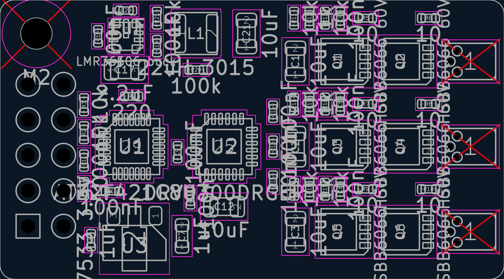
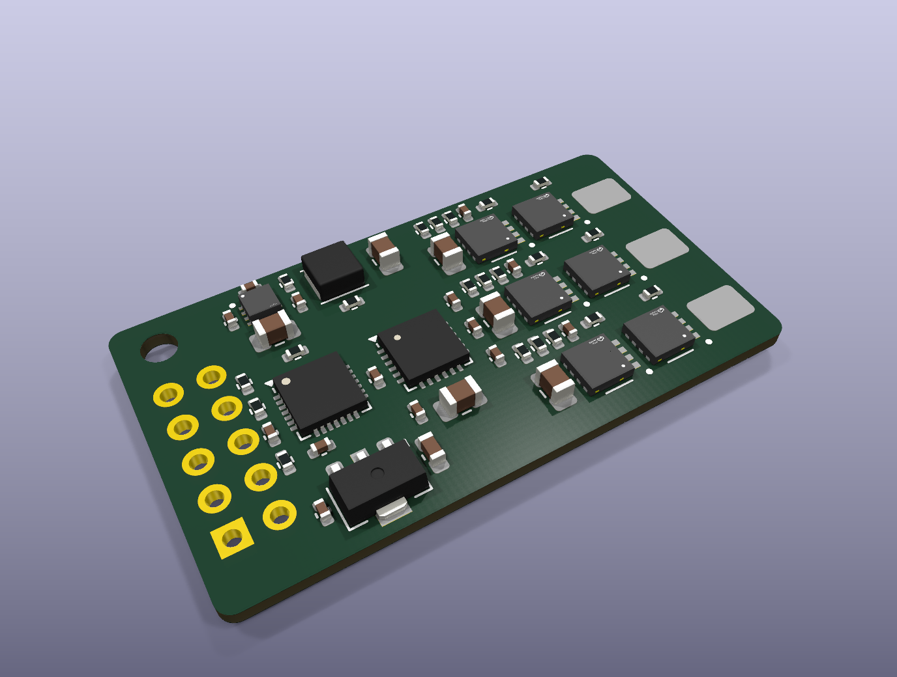
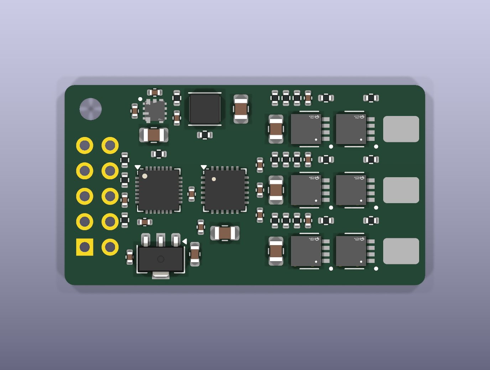
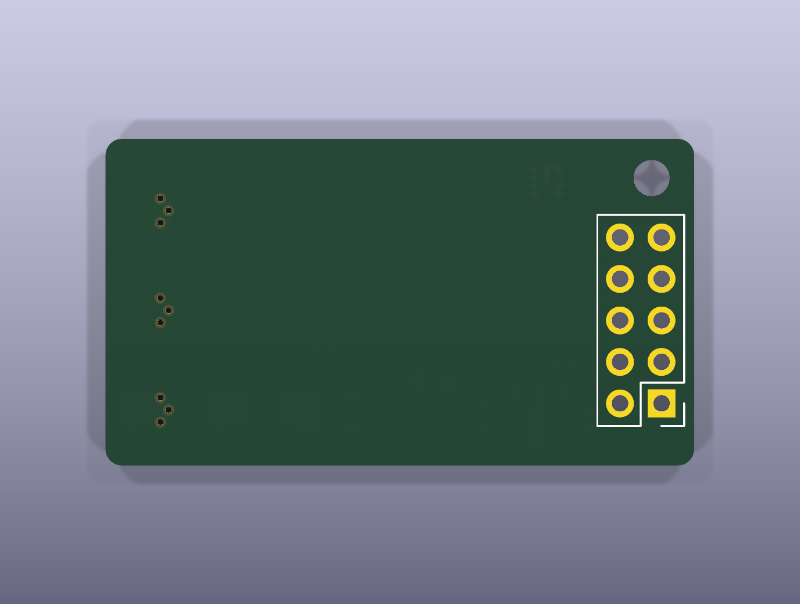

# rebot-esc: review gate 2
_generated 2026-10-11 18:08 · checks FAIL_

## Renders

## Placement rules
- ✓ C9 -> U1 pad 17: 1.43 mm (max 1.9) — MCU VDD decoupling
- ✓ C10 -> U1 pad 5: 2.80 mm (max 3.3) — VDDA decoupling
- ✓ C11 -> U1 pad 4: 1.55 mm (max 2.1) — NRST cap
- ✓ R4 -> U1 pad 25: 1.74 mm (max 2.2) — DShot series resistor at PB4
- ✓ C13 -> U2 pad 4: 3.00 mm (max 3.5) — GVDD HF decoupling
- ✓ C12 -> U2 pad 4: 4.18 mm (max 4.7) — GVDD bulk
- ✓ C14 -> U2 pad 20: 2.75 mm (max 3.3) — bootstrap A at BSTA
- ✓ C15 -> U2 pad 17: 1.54 mm (max 2.0) — bootstrap B at BSTB
- ✓ C16 -> U2 pad 14: 1.98 mm (max 2.5) — bootstrap C at BSTC
- ✓ C18 -> U4 pad 4: 1.26 mm (max 1.8) — buck input HF cap at VIN
- ✓ C17 -> U4 pad 4: 1.51 mm (max 2.0) — buck input cap
- ✓ C19 -> U4 pad 6: 1.30 mm (max 1.8) — buck bootstrap at BOOT
- ✓ C20 -> U4 pad 7: 1.65 mm (max 2.2) — buck VCC cap
- ✓ R21 -> U4 pad 8: 1.39 mm (max 1.9) — feedback divider at FB
- ✓ L1 -> U4 pad 5: 3.23 mm (max 3.7) — inductor at SW
- ✓ C7 -> U3 pad 2: 3.45 mm (max 4.0) — LDO input cap
- ✓ C8 -> U3 pad 3: 2.04 mm (max 2.5) — LDO output cap
- ✓ R5 -> Q1 pad 4: 2.18 mm (max 2.7) — HS gate resistor A
- ✓ R6 -> Q2 pad 4: 2.18 mm (max 2.7) — LS gate resistor A
- ✓ R7 -> Q3 pad 4: 2.13 mm (max 2.6) — HS gate resistor B
- ✓ R8 -> Q4 pad 4: 2.13 mm (max 2.6) — LS gate resistor B
- ✓ R9 -> Q5 pad 4: 2.13 mm (max 2.6) — HS gate resistor C
- ✓ R10 -> Q6 pad 4: 2.13 mm (max 2.6) — LS gate resistor C
- ✓ C1 -> Q1 pad 5: 3.15 mm (max 3.6) — VBAT bulk at HS drain A
- ✓ C2 -> Q3 pad 5: 3.15 mm (max 3.6) — VBAT bulk at HS drain B
- ✓ C3 -> Q5 pad 5: 3.15 mm (max 3.6) — VBAT bulk at HS drain C
- ✓ J2 -> Q2 pad 1: 1.85 mm (max 2.4) — motor pad A next to its low-side FET
- ✓ J3 -> Q4 pad 1: 1.85 mm (max 2.4) — motor pad B
- ✓ J4 -> Q6 pad 1: 1.85 mm (max 2.4) — motor pad C

## Placement intent (from placement.yaml)
- J1: {'at': [2.0, 16.2], 'rot': 0, 'side': 'bottom'}
- H1: {'at': [2.6, 2.4]}
- Q1: {'at': [24.6, 4.4], 'rot': 90}
- Q2: {'at': [29.1, 4.4], 'rot': 90}
- Q3: {'at': [24.6, 10.5], 'rot': 90}
- Q4: {'at': [29.1, 10.5], 'rot': 90}
- Q5: {'at': [24.6, 16.6], 'rot': 90}
- Q6: {'at': [29.1, 16.6], 'rot': 90}
- J2: {'at': [33.6, 4.4], 'rot': 90}
- J3: {'at': [33.6, 10.5], 'rot': 90}
- J4: {'at': [33.6, 16.6], 'rot': 90}
- C1: {'at': [21.1, 4.4], 'rot': 90}
- C2: {'at': [21.1, 10.5], 'rot': 90}
- C3: {'at': [21.1, 16.6], 'rot': 90}
- R11: {'at': [21.0, 1.3], 'rot': 90}
- R12: {'at': [22.1, 1.3], 'rot': 90}
- R13: {'at': [23.2, 1.3], 'rot': 90}
- C4: {'at': [24.3, 1.3], 'rot': 90}
- R5: {'at': [26.1, 1.3], 'rot': 0}
- R6: {'at': [30.6, 1.3], 'rot': 0}
- R14: {'at': [21.0, 7.45], 'rot': 90}
- R15: {'at': [22.1, 7.45], 'rot': 90}
- R16: {'at': [23.2, 7.45], 'rot': 90}
- C5: {'at': [24.3, 7.45], 'rot': 90}
- R7: {'at': [26.1, 7.45], 'rot': 0}
- R8: {'at': [30.6, 7.45], 'rot': 0}
- R17: {'at': [21.0, 13.55], 'rot': 90}
- R18: {'at': [22.1, 13.55], 'rot': 90}
- R19: {'at': [23.2, 13.55], 'rot': 90}
- C6: {'at': [24.3, 13.55], 'rot': 90}
- R9: {'at': [26.1, 13.55], 'rot': 0}
- R10: {'at': [30.6, 13.55], 'rot': 0}
- U2: {'at': [16.0, 10.5], 'rot': 0}
- C14: {'at': [19.5, 8.0], 'rot': 90}
- C15: {'at': [19.5, 10.5], 'rot': 90}
- C16: {'at': [19.5, 13.0], 'rot': 90}
- C13: {'at': [13.6, 14.2], 'rot': 90}
- C12: {'at': [16.0, 14.8], 'rot': 0}
- U1: {'at': [9.4, 10.5], 'rot': 0}
- C9: {'at': [12.68, 10.9], 'rot': 90}
- R1: {'at': [6.0, 13.5], 'rot': 90}
- C10: {'at': [8.0, 13.7], 'rot': 0}
- R2: {'at': [6.0, 9.5], 'rot': 90}
- C11: {'at': [6.0, 11.5], 'rot': 90}
- R3: {'at': [6.0, 7.5], 'rot': 90}
- R4: {'at': [9.4, 6.9], 'rot': 0}
- U4: {'at': [9.0, 2.6], 'rot': 0}
- C20: {'at': [9.0, 0.75], 'rot': 0}
- R21: {'at': [11.2, 1.3], 'rot': 90}
- C19: {'at': [11.2, 3.3], 'rot': 90}
- L1: {'at': [14.0, 2.4], 'rot': 0}
- C21: {'at': [17.6, 2.4], 'rot': 90}
- R20: {'at': [14.0, 5.0], 'rot': 0}
- C18: {'at': [7.0, 2.6], 'rot': 90}
- C17: {'at': [8.9, 5.0], 'rot': 0}
- U3: {'at': [9.6, 17.4], 'rot': 270}
- C7: {'at': [13.0, 16.9], 'rot': 90}
- C8: {'at': [6.5, 17.2], 'rot': 90}
